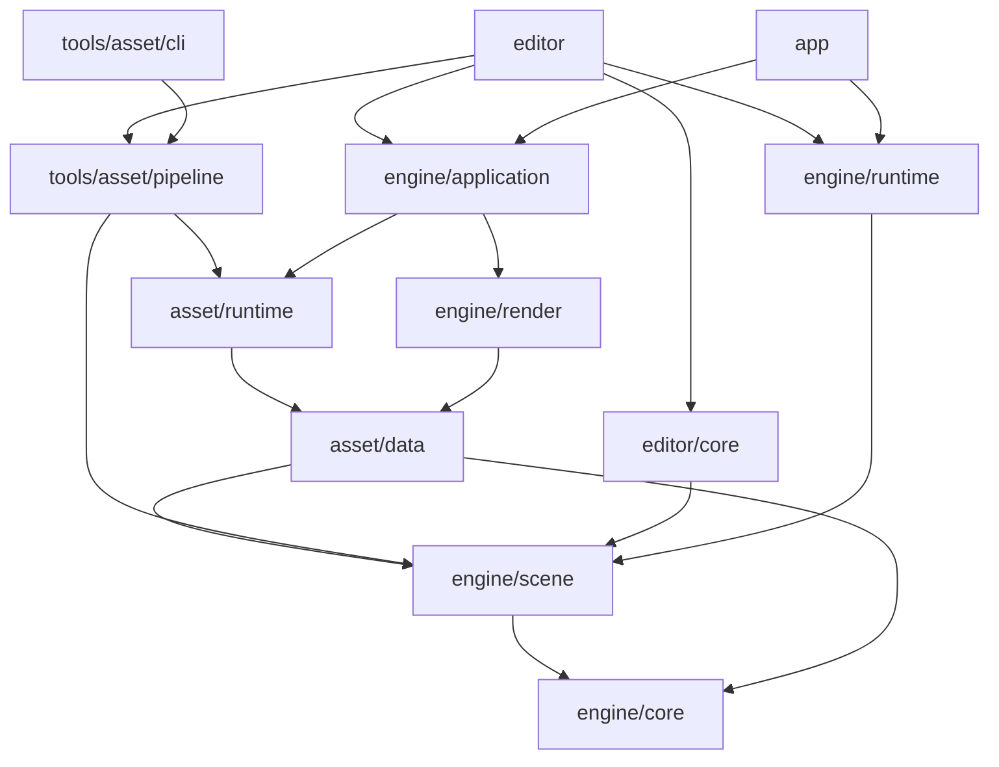

# 架构与目录约定

项目按引擎、编辑器、游戏与工具组织。Cargo 包是依赖和编译边界，目录使用业务含义，不按开发阶段建立产品结构。
原生 Vulkan/Metal 为图形路线；后端保留显式多队列、原生显存别名和硬件光追的控制空间。Windows 与 DX12 低优先级。

## 目录与依赖

```text
engine/
  core/                  identity.rs / storage.rs
  scene/                 components.rs / schema.rs / scene.rs / prefab.rs
  asset/data/            product.rs：CPU 产品协议
  asset/runtime/         store.rs：只读产品消费
  runtime/               session.rs：独立运行世界
  application/           application.rs / extract.rs：窗口、输入与提取
  render/                frame.rs / worker.rs / shader.rs
    shaders/             正式 WGSL
    src/backend/metal/   renderer.rs / resources.rs / ui.rs
    src/backend/vulkan/  renderer.rs / device.rs / resources.rs / pipeline.rs / commands.rs / ui.rs
editor/
  core/                  document.rs：编辑文档与历史
  src/                   session.rs / ui/{mod.rs,inspector.rs,gizmo.rs}
app/src/                 游戏入口
tools/asset/pipeline/    import.rs / build.rs / gltf.rs / package.rs
tools/asset/cli/         资产 CLI
tools/gpu/               原生 GPU 能力诊断
demo/assets/             默认作者项目
tests/fixtures/          按功能组织的独立测试项目
```



图中表示主要编译依赖，实际直接依赖由 `tools/check_boundaries.py` 校验。`asset/data` 不导入源文件、不持有 Store 或 GPU；Render 可以依赖这些数据协议，但不依赖资产运行时加载器。`asset/runtime` 表示资产消费，`engine/runtime` 表示游戏运行，二者职责不同。
Player 不链接编辑器、资产生产库、glTF 或图像解码器；Render 的 png 依赖用于截图编码。数据层、资产生产和编辑文档不依赖窗口、GPU、模拟世界或脚本 VM。GPU 工具独立运行，不是游戏依赖。
`lib.rs` 组织模块和公共出口；不使用包揽项目状态的 Engine/Context 单例。

## 第三方依赖

第三方 Rust 库由 Cargo 下载到本机缓存（通常为 `$CARGO_HOME/registry`，默认 `$HOME/.cargo/registry`），不在仓库中复制一份 `3rdparty` 源码。
根 `Cargo.toml` 的 `[workspace.dependencies]` 管理共享约定，各包的 `Cargo.toml` 声明实际使用；`Cargo.lock` 锁定全部解析版本，更新依赖时一并审查。

### 已接入的主要依赖

| 用途 | 依赖 | 主要声明位置 |
| --- | --- | --- |
| 场景 ECS | `bevy_ecs` | `engine/scene/Cargo.toml` |
| 数学 | `glam` | 根 workspace、Render、Application、Editor |
| 序列化 | `serde`、`serde_json` | 根 workspace，各数据和工具模块 |
| 身份与摘要 | `uuid`、`sha2` | 根 workspace、`engine/core` |
| 错误上下文 | `anyhow` | 根 workspace、各消费者 |
| Vulkan 绑定与 Surface | `ash`、`ash-window` | `engine/render`，非 macOS 目标 |
| Metal 与系统对象绑定 | `objc2`、`objc2-metal`、Foundation、QuartzCore | `engine/render`、`tools/gpu`，macOS 目标 |
| 原生窗口句柄 | `raw-window-handle`、`raw-window-metal` | `engine/render` |
| Shader 翻译 | `naga` | `engine/render`：WGSL 输入、MSL/SPIR-V 输出 |
| 窗口与 UI | `winit`、`egui`、`egui-winit` | 根 workspace、Application、Editor、Render |
| 静态模型导入 | `gltf`、`base64`、`percent-encoding` | `tools/asset/pipeline` |
| PNG/JPEG 解码 | `image`、`png` | `tools/asset/pipeline` |
| 验收截图编码 | `png` | `engine/render`，不用于导入作者源 |
| 临时测试项目 | `tempfile` | 各包的开发依赖 |

项目只使用 bevy_ecs，不接入完整 Bevy 引擎；稳定字段 Schema 由本项目实现。Metal/Vulkan 的系统 SDK、loader 与驱动由系统提供，Cargo 包负责 Rust 绑定与调用。
原生 API 的 Rust 绑定可能携带构建脚本，但不等于编译 C/C++ 算法库；实际 normal/build 依赖图由审计工具检查。

### 已确定、尚未接入

| 功能 | 技术路线 | 状态 |
| --- | --- | --- |
| 物理与角色运动 | Rapier | 尚未接入正式 Runtime |
| 导航构建与寻路 | rerecast / landmass | 尚未接入正式 Runtime 和资产产品 |
| 游戏脚本 | Rhai | 尚未接入正式 Runtime |

按实际消费者接入这些路线，不提前加入无消费者的依赖或原型构建路径。导航动态几何修改采用受影响区域重新烘焙并替换产品，局部避障不能替代几何切割；Rhai 与按阶段回调的脚本生命周期匹配。这些约束尚未进入正式 Runtime。
Rune 与 wgpu 不属于当前正式路线；引擎不依赖旧 C++ 引擎或 Jolt、Recast、glslang 等 C/C++ 实现。

## 身份、场景与字段

`EntityId`、`AssetId`、`InstanceId`、`WorldId` 为不同的非空 UUID 类型。ECS 槽位、内存地址和递增整数不作为持久身份。
Scene 私有持有 bevy_ecs World，存储 Identity、Transform、Model、Links 具体组件；SceneSnapshot 是可独立验证和序列化的 CPU 值。
实体句柄携带世界与代次，跨世界或替换场景后失效。parent 唯一确定层级，Transform 使用父级局部变换；拒绝重复身份、缺失父级、层级环及无效本地引用。
实体引用区分 Local 与 External；External 保存场景资产和实体身份，当前校验所指资产为场景，不自动实例化跨场景内容。

| 组件 ID | 字段 ID | 协议字段 | 规则 |
| --- | --- | --- | --- |
| 1 Transform | 1/2/3 | translation / rotation / scale | 有限向量、归一化 xyzw 四元数 |
| 2 Model | 1/2/3 | mesh / surface.material / surface.roughness | 资产身份、资产身份、[0,1] 标量 |
| 3 Links | 1/2 | target / connections | 可空实体引用、实体引用数组 |

字段 ID 和 JSON 键属于版本化协议，不随 Rust 字段重命名而改变。编辑与 Prefab 覆盖使用稳定的组件/字段 ID。
Schema 的读写、校验、引用分类和重映射供各消费者复用。复制子树分配新身份，重映射复制集合内的父级与本地引用，保留集合外引用及资产身份；候选校验成功后整体生效。

## 文档与运行世界

ContentSource 保存 base SceneSnapshot 与 PrefabInstance 声明，场景和 Prefab 共用作者格式。实例保存 InstanceId、Prefab AssetId、挂接父实体与字段覆盖。
实例实体身份由实例和源实体 UUID 确定性派生，嵌套实例同理；源更新后身份稳定，覆盖重新应用。展开检查循环、缺失依赖、目标及类型，最多 64 层，不创建临时 ECS 世界收集依赖。
当前覆盖目标是被引用 Prefab 的 base 实体，尚不支持跨层结构覆盖、移除源实体或完整结构编辑 UI。

Document 拥有 Edit 场景、Prefab 声明、历史与保存点。连续预览 commit 后成为一条历史；cancel 恢复。保存先原子发布作者文件，成功后移动保存点；失败保留 dirty 状态。作者文件保留声明和覆盖，不保存为失去关系的平铺实体。
历史目前保存完整 CPU 快照。Play 从已校验快照创建新的运行世界，Stop 销毁运行世界；编辑文档的所有权和历史不参与交换。
Runtime 当前提供时间、暂停与 1/60 秒单步，游戏物理、动画、脚本、导航和音频尚未接入。

## 资产生产与消费

1. Pipeline 扫描项目 `assets/`，导入 `.scene`、`.prefab`、`.mesh`、`.material`、PNG、静态 glTF/GLB；前四种自有作者格式仍使用 JSON 内容。
2. 源旁的 `<文件名>.meta` 保存版本与 AssetId。重命名时随源移动；复制为新资产时分配新身份。目录重构保留现有 metadata 与协议版本。
3. 构建持有项目与输出锁，读取输入快照，校验内容、引用类型、依赖及展开；发布前复核源集合、字节、metadata 和外部文件。
4. 产品写入 `products/<AssetId>/<SHA256>.json`，保存版本、身份、输入摘要及 CPU payload。相同内容复用文件，不就地覆盖旧版本。
5. 最后通过同目录临时文件、sync 与 rename 原子发布 `index.json`；失败时旧索引仍可使用。当前不自动清理旧产品版本。
6. AssetStore 只读产品目录。打开与刷新时全量校验候选索引、摘要、协议、依赖及展开，成功后切换；缓存使用 Arc，消费者已持有的旧版本继续有效。

当前构建仍解析全部源，复用的是未变化的产品文件，尚无导入计算缓存。资产打开/刷新仍全量验证，尚未实现大场景按需流送。
自有源、metadata、产品和索引有显式版本，未知版本/字段报错。旧 C++ 自有格式需显式单向迁移；源路径不参与资产身份。
源文件与 metadata 使用简短后缀，例如 `main.scene` / `main.scene.meta`、`showcase.gltf` / `showcase.gltf.meta`，metadata 追加到完整源文件名，避免同名不同类型的资产共享身份文件。遇到旧复合后缀时构建会报错；需一起重命名源与 metadata，保留文件内容和 UUID，避免遗漏资源或重新分配身份。

glTF/GLB 按 primitive 生成稳定网格、材质、纹理子产品，保留节点层级与 TRS，支持外部/内嵌 buffer、PNG/JPEG、无索引三角形与缺失法线生成。外部 URI 限本地同目录或子目录，读取的外部文件参与输入复核。
子身份按源 AssetId、语义和唯一名称派生；无名/重名项及 primitive 使用索引，重命名或索引变化可能使旧覆盖失效并报错。
当前材质为不透明 metallic/roughness、base-color factor/texture、UV0；尚无蒙皮、动画、morph、稀疏 accessor、必需扩展、透明、法线/遮蔽/自发光或 packed metallic-roughness 贴图支持。

## 宿主、渲染与反馈

Application 在主线程处理 winit/egui 事件和本轮应用更新，再只读场景与资产，提取不可变帧数据。egui 固定单 pass，避免布局重排重放命令。窗口保留到 Surface 和 Worker 退出后。
RenderWorker 在专用线程创建后端，使用 1 个待处理帧槽、2 个反馈槽提供背压；关闭时断开发送与反馈再 join，避免反馈满导致死锁。诊断只保留最近 120 条。
帧与拾取反馈携带帧号、WorldId、View 和目标代次；resize/零尺寸更新代次，拒绝旧世界或旧目标反馈。当前拾取为帧快照上的 CPU 三角形射线检测。

渲染显式执行 Shadow → PBR/Depth → UI。共享 WGSL、顶点与 uniform 布局，由 Naga 生成 MSL/SPIR-V；后端负责原生资源、上传、缓存、命令和呈现。
Metal 使用 CAMetalLayer；主线程创建的 Surface 按 `raw-window-metal` 契约交给 Worker，不自定义未证明安全的 Send/Sync。Vulkan 使用 ash、原生分配/绑定、RenderPass、Fence/Semaphore 和 Swapchain。
投影为 Z∈[0,1]、Y-up，Vulkan 采用负 viewport height 保持一致。

正式渲染目前为单队列并等待本帧 GPU 完成，CPU 可以准备下一帧；尚无 GPU 多帧并行、RenderGraph 或独立异步上传。多队列/显存别名/光追的 Metal 直接能力检查保留在 `tools/gpu`，不代表正式帧调度已经接入，也不代表整帧性能提升。

## 打包与目录稳定性

`assetc pack` 校验入口场景依赖闭包，复制已构建 Player、所需产品和 `package.json` 到全新目录，不覆盖现有目录。Player 相对自身可执行文件解析包，不依赖工作目录，也不读取作者源。
当前可输出可搬移的可执行文件与产品目录，完整应用包、签名与安装流程尚未实现。只有显式传入 `--capture`/`--report` 时写验收文件。
目录和包命名按业务职责维护。阶段编号仅用于迁移计划，不进入正式源码、示例路径、包名和当前验收命令。
