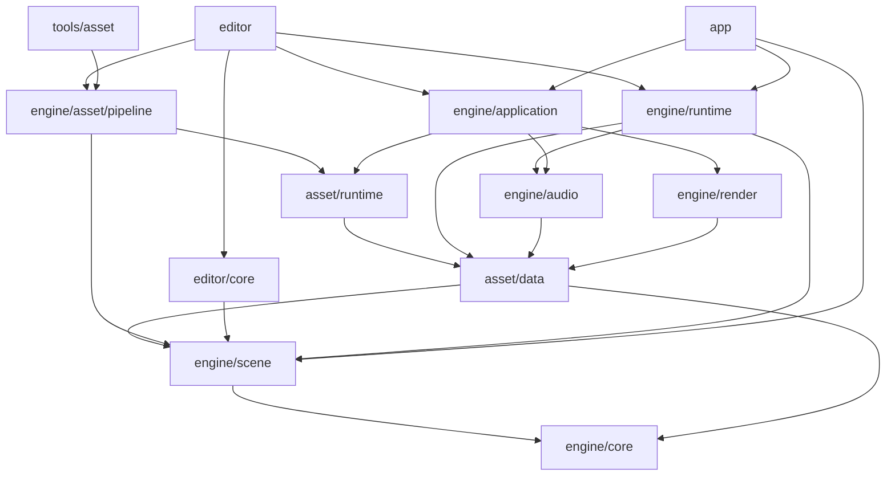

# 架构与目录约定

项目按引擎、编辑器、游戏与工具组织。Cargo 包是依赖和编译边界，目录使用业务含义，不按开发阶段建立产品结构。
桌面共同支持目标为 macOS、Windows、Linux；macOS 使用原生 Metal，Windows/Linux 共用原生 Vulkan 后端，暂不接入 DX12。新增通用功能按三个平台同步设计、实现和验收，平台差异收敛在 Application、Render 后端、Audio 输出和打包适配中。共享数据协议与行为，硬件能力差异由显式能力检测和错误体现；后端保留显式多队列、原生显存别名和硬件光追的控制空间。

## 重构设计与验收原则

**架构质量是每项重构的交付要求。** 每次迁移都要同时考虑职责、复用、复杂度与后续维护，不能以功能接通为由把结构整理留到最后。开发前检查已有实现和旧项目的经验，开发中保持边界，验收前清理本次引入或暴露的重复与过时内容。

- **先确定归属，再扩展实现。** 明确数据由谁拥有、规则由谁维护、消费者通过什么接口访问，以及依赖方向和失败边界。入口负责参数和启动，会话负责流程协调，面板负责展示与交互，业务规则进入所属模块；避免逐步堆成包揽状态和规则的会话、面板或工具文件。
- **旧项目提供行为依据，Rust 工程按当前需求设计。** 对照旧版的功能、数据语义与失败处理；编辑器操作结合 Rust、egui 和实际工作流选择方便的方式。调整交互时保持操作结果、撤销、保存和 Play 隔离等语义清楚，并同步迁移清单。
- **复用已有规则，控制抽象规模。** 路径、源扫描、metadata、身份、校验和事务发布等公共规则应有明确的维护入口；新增消费者先检查能否复用。发现职责不清或重复实现时及时合并、替换或删除；抽象必须有实际消费者，不提前建设空模块、通用框架或可选原型路径。原生后端需要直接控制的差异保留在各自适配层。
- **第三方与平台细节在适配边界内收敛。** 数学入口、ECS、物理、窗口和图形绑定按已有边界接入，持久数据与公共业务协议保持项目自身语义。接口隔离程度按替换成本和实际用途决定，避免到处直接操作第三方内部对象，也避免无实际作用的逐层包装。
- **正确性与资源成本一起设计。** 修改先校验候选，再发布状态；失败保留已接纳内容。明确对象生命周期、线程退出和历史容量；常规查询复用只读数据，避免把全场景复制、目录扫描或导入工作放进每帧路径。新增缓存要说明失效条件，性能结论以实际证据为准。
- **测试按访问边界与行为组织。** 覆盖失败恢复、身份稳定、历史与运行隔离等高风险行为，清理只复述接线或字段映射的测试；共用临时项目和既有 fixtures，不为测试扩大正式 API。新增、清理和目录组织统一遵循[单元测试约定](development.md#单元测试)，三平台结果分别记录。
- **注释和文档维护当前设计。** 注释解释设计原因、协议与安全前提，删除失效或只复述代码的内容。README 说明使用方式，本文维护架构与依赖，development.md 维护开发与验证，migration.md 追踪能力差距；变更时同步核对相关说明，避免重复维护同一套规则。日志、截图和阶段报告留在生成物目录，正式源码与默认示例保持完整项目的命名和结构。

每项迁移在标记完成前，都要能说明：实现归属及依赖为何合理，复用了什么或为何保留差异，清理了哪些旧实现，失败与资源边界如何验证，以及哪些平台仍待实测。存在未解决的结构问题时，在迁移清单中明确记录，不能默认为后续优化已经覆盖。

## 中文界面与旧版对照

同一功能沿用旧版中文术语；更换界面框架或调整布局不构成改名理由。迁移时同时核对菜单、按钮、组件、属性、提示、Prefab 覆盖列表及使用文档。功能范围或数值含义变化时，用准确名称说明差异，不借用尚未迁移功能的名称。对照版本见[迁移基线](migration.md)，主要依据旧仓库的 `editor/src/ui/menu_bar.cpp`、`editor/src/scene/hierarchy.cpp`、`editor/src/inspector/inspector.cpp` 和 `demo/assets/ui/runtime.rml`。

| 功能或组件 | 当前界面用语 | 对照与差异 |
| --- | --- | --- |
| 场景保存 | 保存场景 | 沿用旧版；编辑原生 Prefab 时显示“保存 Prefab” |
| 场景与 Prefab 打开 | 打开场景 / Prefab | 旧版“打开场景”的入口扩展为两种作者文件，不只打开场景 |
| App 导出 | 导出 App... | 沿用旧菜单名称；窗口标题为“导出 App” |
| 资产面板 | 项目 | 沿用旧项目面板名称；“刷新资源”仍表示当前手动构建并接纳资源的操作 |
| Entity | 实体、创建实体、创建子实体 | 沿用旧层级面板术语；已有用户命名保持原样 |
| 多选 Inspector | 共同属性、多值 | 沿用旧版主目标显示、组件交集、混合开关与按轴修改规则；开放局部 TRS、已有网格/材质替换及已接入组件的数值/开关，Play 只读 |
| 脚本与动画资源字段 | 脚本、音频片段、播放片段 | 沿用旧版字段名；动画组件标题为“动画”，共同菜单按兼容条件提供候选 |
| Model / mesh_renderer | 网格渲染 | 模型仍指源模型资产；组件增删使用“添加/移除网格渲染” |
| Character / character_controller | 角色控制器 | 当前只支持胶囊；“添加角色控制器”在缺少刚体时一并创建所需刚体 |
| 刚体运动与形状 | 静态、动态、运动学；盒体、球体、胶囊 | 沿用旧属性选项 |
| PointJoint / HingeJoint / SliderJoint | 点关节、铰链关节、滑动关节 | 组件、增删按钮与覆盖列表使用同一名称 |
| 关节锚点、限位与 motor | 本地锚点、连接锚点；角度限位、行程限位；驱动 | 沿用旧属性术语；连接锚点继续注明本地或世界空间，限位仍只有硬限位 |
| AudioSource | 音频源 | 沿用旧组件名，播放/停止声音是运行操作 |
| 音频源属性 | 音频片段、启动时播放、空间音效、开始衰减距离、最大距离 | 沿用旧标签；当前固定衰减规则不等于旧版可调衰减强度 |
| Animator | 动画、播放片段、循环、播放速度 | 沿用旧组件名；“动画控制器”专指 `.ani` 状态机资产 |
| SkinBinding | 蒙皮资源、动画实体 | 当前显式绑定方式；动画实体指持有 Animator 的实体，不是状态机资产 |
| 游戏保存 | 保存进度、继续存档 | 沿用旧游戏用语；当前手动保存单槽检查点，Editor 预览仅在内存中保留，未接入自动保存 |
| 单位与参数含义 | 质量 (kg)、移动/蹲伏/跳跃速度 (m/s)、地面吸附距离 (m) | 同量使用旧标签与单位；跑步倍率、重力 (m/s²)、胶囊半高（不含端部，米）分别是倍率、绝对加速度和半高，不套用旧版跑步速度、重力倍率或胶囊总高度 |

## 目录与依赖

```text
engine/
  core/                  identity.rs / storage.rs / input.rs / paths.rs / publication.rs / math.rs
  scene/                 components.rs / physics.rs / joints.rs / navigation.rs / audio.rs / script.rs / schema.rs / scene.rs / prefab.rs
  asset/data/            product.rs / navigation.rs / navigation/ / audio.rs：CPU 产品、导航输入与 PCM 协议
  asset/runtime/         store.rs：只读产品消费
  asset/pipeline/        source.rs：源目录与身份；导入、构建、打包、模板与项目配置库
  runtime/               session.rs / clock.rs / input.rs / physics.rs / character.rs / navigation.rs / audio.rs / script/：运行世界、模拟与脚本
  audio/                 frame.rs / output.rs：中立声音帧与私有 Kira/CPAL 输出
  application/           application.rs / extract.rs / audio.rs / input.rs / timing.rs / icon.rs / macos.rs：宿主、采样、输出、图标与提取
    resources/fonts/     内置中文字体与许可
  render/                frame.rs / transform.rs / worker.rs / shader.rs
    shaders/             正式 WGSL
    src/backend/metal/   renderer.rs / resources.rs / ui.rs
    src/backend/vulkan/  renderer.rs / device.rs / resources.rs / pipeline.rs / commands.rs / ui.rs
editor/
  core/                  document.rs：编辑文档与历史
  src/                   main.rs：启动；session.rs：会话；documents.rs / objects.rs / fields.rs / selection.rs / picking.rs / transform.rs
                         models.rs / validation.rs / resources.rs / navigation.rs / audio.rs / scripts.rs / console.rs / export.rs / project.rs / jobs.rs
    ui/                  面板与交互；层级、资源、属性和 Gizmo 各归所属文件
  resources/icons/       编辑器原版 PNG / ICNS / ICO 图标
app/
  src/                   main.rs：启动；session.rs：运行会话；menu.rs：暂停菜单；settings.rs：有效设置与文件协议；storage.rs：包外存储
  resources/icons/       独立游戏原版 PNG / ICNS / ICO 图标
tools/
  asset/                 资产 CLI：Cargo.toml / src/main.rs
  gpu/                   原生 GPU 能力诊断：Cargo.toml / src/ / shaders/
  launch/                launch.py / program_cache.py / windows_icon.py / build.rs / tests/：编辑器启动准备
  verify/                verify.py / linux_sdk.py / check_boundaries.py / audit_dependencies.py：工程验收与审计
demo/assets/             默认作者项目
tests/fixtures/          按功能组织的独立测试项目
```



图中表示主要编译依赖，实际直接依赖由 `tools/verify/check_boundaries.py` 校验。`asset/data` 不导入源文件、不持有 Store 或 GPU；Render 可以依赖这些数据协议，但不依赖资产运行时加载器。`asset/runtime` 表示资产消费，`engine/runtime` 表示游戏运行，二者职责不同。
资产 Pipeline 是引擎的生产库，独立 Cargo 包 `comet-asset-pipeline` 供编辑器与资产 CLI 调用；tools/asset 只保留命令行入口。tools/launch 和 tools/verify 分别编排启动准备与工程验收，继续使用 Python 标准库。
App 直接使用 SceneSnapshot/EntityRef 准备 Runtime 候选和只读姿态报告，运行世界与变更仍由 Runtime 管理。App 不链接编辑器、资产生产库、glTF 或通用源图像导入器；Application 使用 png 解码内置或包内窗口图标，Render 使用它编码截图。数据层、资产生产和编辑文档不依赖窗口、GPU、模拟世界或脚本 VM。GPU 工具独立运行，不是游戏依赖。
App 的 main.rs 解析启动参数、包身份与存储方式，session.rs 协调运行世界、检查点和已接纳输出偏好；menu.rs 只管理 egui 草稿与用户意图，settings.rs 负责有效值校验及私有文件封装，storage.rs 统一两种固定文件的目录和原子 I/O。菜单不持 Store 或 Runtime，不建立通用 Service 层。
Render 的直接工程依赖只保留 Core 与资产数据；Scene 和 Store 的访问归 Application 提取阶段，后端只消费已经准备好的帧与产品。
`lib.rs` 组织模块和公共出口；不使用包揽项目状态的 Engine/Context 单例。

## 第三方依赖

第三方 Rust 库由 Cargo 下载到本机缓存（通常为 `$CARGO_HOME/registry`，默认 `$HOME/.cargo/registry`），不在仓库中复制一份 `3rdparty` 源码。
根 `Cargo.toml` 的 `[workspace.dependencies]` 管理共享约定，各包的 `Cargo.toml` 声明实际使用；`Cargo.lock` 锁定全部解析版本，更新依赖时一并审查。

### 已接入的主要依赖

| 用途 | 依赖 | 主要声明位置 |
| --- | --- | --- |
| 刚体与角色碰撞 | `rapier3d = 0.36.1` | 根 workspace、`engine/runtime/Cargo.toml` |
| 离线导航烘焙 | `rerecast = 0.5.0` | 根 workspace、`engine/asset/pipeline` 私有适配 |
| 路径与局部避障 | `landmass = 0.9.3` | 根 workspace、`engine/runtime` 私有适配 |
| 声音混音与设备输出 | `kira = 0.12.5`、`cpal = 0.18.2` | `engine/audio` 私有适配 |
| PCM16 WAV 导入 | `hound = 3.5.1` | `engine/asset/pipeline`，运行时不解码 WAV |
| 场景 ECS | `bevy_ecs` | `engine/scene/Cargo.toml` |
| 数学 | `glam` | 根 workspace、Core；消费者使用 `comet_core::math` |
| 序列化 | `serde`、`serde_json` | 根 workspace，各数据和工具模块 |
| 身份与摘要 | `uuid`、`sha2` | 根 workspace、`engine/core` |
| 错误上下文 | `anyhow` | 根 workspace、各消费者 |
| Vulkan 绑定与 Surface | `ash`、`ash-window` | `engine/render`，非 macOS 目标 |
| Metal 与系统对象绑定 | `objc2`、`objc2-metal`、Foundation、QuartzCore | `engine/render`、`tools/gpu`，macOS 目标 |
| 原生窗口句柄 | `raw-window-handle`、`raw-window-metal` | `engine/render` |
| Shader 翻译 | `naga` | `engine/render`：WGSL 输入、MSL/SPIR-V 输出 |
| 窗口与 UI | `winit`、`egui`、`egui-winit`、`egui_tiles` | 根 workspace、Application、Editor、Render |
| 静态模型导入 | `gltf`、`base64`、`percent-encoding` | `engine/asset/pipeline` |
| PNG/JPEG 解码 | `image`、`png` | `engine/asset/pipeline` |
| 窗口图标解码、验收截图编码 | `png` | `engine/application` / `engine/render`，不用于导入作者源 |
| 游戏脚本 | `rhai` | `engine/runtime` 私有 VM；资产 Pipeline 只构建源码产品 |
| 临时测试项目 | `tempfile` | 各包的开发依赖 |

数学类型通过 Core 的小型门面集中导出，渲染准备中的 DMat3/DVec3 双精度计算同样从此入口使用；坐标/投影约定在同一处；门禁拒绝其他正式包直接依赖 glam。类型导出保留 glam 的实际类型身份，尚不是独立数值实现或稳定二进制 ABI。Rapier 内部数值类型留在 Runtime 适配层，持久协议继续使用既有数组。
项目只使用 bevy_ecs，不接入完整 Bevy 引擎；稳定字段 Schema 由本项目实现。Metal/Vulkan 的系统 SDK、loader 与驱动由系统提供，Cargo 包负责 Rust 绑定与调用。
原生 API 的 Rust 绑定可能携带构建脚本，但不等于编译 C/C++ 算法库；实际 normal/build 依赖图由审计工具检查。

导航使用独立 Rust 库，不接入 `landmass_rerecast` 的 Bevy 插件。两个 SDK 的坐标及不同 glam 类型只在各自适配内转换，跨层数据使用数组；不通过新增直接 glam 依赖暴露 SDK 类型。当前接入范围见[离线导航](#离线导航)，动态几何切割、跨区域与跳跃连接尚未实现，局部避障不替代它们。
Rune 与 wgpu 不属于当前正式路线；引擎不依赖旧 C++ 引擎或 Jolt、Recast、glslang 等 C/C++ 实现。

## 身份、场景与字段

`EntityId`、`AssetId`、`InstanceId`、`WorldId` 为不同的非空 UUID 类型。ECS 槽位、内存地址和递增整数不作为持久身份。
Scene 私有持有 bevy_ecs World，存储 Identity、Transform、Model、Links、PhysicsBody、Character、Script、三类关节、导航及 AudioSource 具体组件；SceneSnapshot 是可独立验证和序列化的 CPU 值。
实体句柄携带世界与代次，跨世界或替换场景后失效。parent 唯一确定层级，Transform 使用父级局部变换；拒绝重复身份、缺失父级、层级环及无效本地引用。
实体引用区分 Local、InInstance 与 External。Local 指向当前作者命名空间中的实体；InInstance 保存当前 ContentSource 的实例声明 UUID 与源实体 UUID，要求 Scene10，不能把展开后的派生 UUID 当作作者 Local 保存。展开按声明的词法作用域先解析直接实例，再将结果映射到外层，嵌套引用不搜索后代；Prefab override 中的引用沿被覆写源的命名空间解析。Links、脚本参数、关节、导航和动画绑定共用 Schema 的引用遍历、复制重映射、版本升级与实例删除清理。展开后只保留 Local/External，Runtime 与帧提取拒绝未解析的 InInstance。External 保存场景资产和实体身份，当前校验所指资产为场景，不自动实例化跨场景内容。

| 组件 ID | 字段 ID | 协议字段 | 规则 |
| --- | --- | --- | --- |
| 1 Transform | 1/2/3 | translation / rotation / scale | 有限向量、归一化 xyzw 四元数 |
| 2 Model | 1/2/3 | mesh / surface.material / surface.roughness | 资产身份、资产身份、[0,1] 标量 |
| 3 Links | 1/2 | target / connections | 可空实体引用、实体引用数组 |
| 4 PhysicsBody | 1/2 | mass / friction | 正质量、非负摩擦系数 |
| 5 Character | 1/2/3/4 | move_speed / jump_speed / crouch_speed / crouch_height_ratio | 正速度、高度比例 (0,1] |
| 6 Script | 1/2/3 | asset / enabled / parameters | 脚本资产、启用、具名带类型参数 |
| 7 PointJoint | 1/2/3/4/5 | enabled / connection / anchor / connected_anchor / contacts_enabled | 启用、连接、双端锚点、连接体间碰撞 |
| 8 HingeJoint / 9 SliderJoint | 1–5、8/9/10/11 | 公共字段、rotation / connected_rotation / limits / motor | 双端局部坐标系、可选硬限位与驱动 |
| 10 NavigationRegion | 1–7 | data / half_extents / cell_size / agent_radius / agent_height / max_climb / max_slope_degrees | 可空导航资产、世界米数与度；轴对齐根区域 |
| 11 NavigationAgent | 1/2/3 | enabled / target / arrival_distance | 启用、可空 EntityRef、正到达距离 |
| 12 AudioSource | 1–7 | clip / gain / looping / autoplay / spatial / min_distance / max_distance | 音频资产、[0,1] 音量、播放设置、空间开关与米制近远距离；5–7 要求 Scene8 |
| 13 Animator | 1–6 | skeleton / clip / bindings / looping / speed / controller | 原字段要求 Scene9；可选控制器与 Clip 互斥，字段 6 要求 Scene11 |
| 14 SkinBinding | 1–2 | skin / animator | Skin 资产与可选动画实体引用；与 Model 共存，要求 Scene9 |
| 15 CharacterAnimation | 1–2 | character / animator | 视觉容器绑定父角色与后代动画实体，要求 Scene11 |

场景快照当前版本为 11；仍读取版本 1–10。版本 11 增加 Animator.controller 与 CharacterAnimation；缺失字段不补写，旧场景保持原版本。版本 10 增加 InInstance 实体引用，旧版本不能夹带该引用；文档按具体字段值显式升级，旧 Local/External 引用不因此升级。版本 9 增加可选 Animator 与 SkinBinding；旧版本不能夹带这些组件，缺失字段不补写。版本 8 增加 AudioSource 空间配置，缺少字段时默认 spatial=false、近距 1 米、远距 30 米；默认值不写入旧 2D 格式，普通 Scene7 打开、保存和构建保留版本。空间启用或非默认距离要求版本 8，新 Schema 字段覆盖同样要求版本 8。版本 7 增加可选 `audio_source`，版本 6 增加可选 `navigation_region`、`navigation_agent`，版本 5 增加三种可选关节，版本 4 增加可选 Script；缺少这些组件的旧场景保留原协议。版本 2 支持可选 `physics`、`character`，版本 3 增加可配置蹲伏速度和高度比例。旧场景缺少蹲伏字段时使用默认值（2、0.6），默认字段不额外写入旧格式；版本 1 不允许物理组件，版本 2 不允许非默认蹲伏配置。最低协议由 Scene 的 EntityData 按实际组件配置及引用值统一计算，Scene 校验和 Document 组件/插入候选复用同一规则；字段与覆盖同时考虑字段版本和具体值。只打开和保存旧场景保留版本与 UUID，显式编辑才升级，撤销可恢复旧版本。Prefab 新字段覆盖也升级作者 base，展开时只升级被覆写候选并合成最高版本，不修改源 Prefab。ContentSource 外层版本仍为 1；产品需随协议实现重新构建，metadata 身份不变。
Scene 同时检查局部字段和组合后的世界矩阵，有限本地数值不能绕过层级乘积溢出校验。字段候选、场景替换、Prefab 覆盖与姿态写回在成功发布前共用组合规则；Prefab 的同一实例覆盖一次批量校验，不以逐字段的临时状态拒绝合法最终结果。姿态快路径只借用当前 Identity/Transform 和待写姿态，不克隆 EntityData 或脚本参数；变化时重算世界矩阵，组合 O(N log N)、辅助空间 O(N)，无变化沿用早退。结构/引用校验仍有其原有成本，不据此承诺整个 Scene 验证已线性化。

PrefabRoot 是不序列化的派生元数据，由真实展开同步收集源实体、相对嵌套 InstanceId 路径和根层级约束。实例化及复制沿路径逐层组合 scope 后再派生实体 UUID，不能对已展开 UUID 再套一次 instance，也不能按新旧随机 UUID 排序配对。Editor 每条结构命令按 AssetId 缓存这类轻量元数据，同实例多根合并为一次操作并保留各选中根及点击锚点；发布后选择映射不读取资源。内部非根节点仍不提供结构覆盖。

字段 ID 和 JSON 键属于版本化协议，不随 Rust 字段重命名而改变。编辑与 Prefab 覆盖使用稳定的组件/字段 ID。
Schema 的读写、校验、引用分类和重映射供各消费者复用。复制子树分配新身份，重映射复制集合内的父级与本地引用，保留集合外引用及资产身份；候选校验成功后整体生效。

## 文档与运行世界

ContentSource 保存 base SceneSnapshot 与 PrefabInstance 声明，场景和 Prefab 共用作者格式。实例保存 InstanceId、Prefab AssetId、挂接父实体与字段覆盖。
实例实体身份由实例和源实体 UUID 确定性派生，嵌套实例同理；源更新后身份稳定，覆盖重新应用。展开检查循环、缺失依赖、目标及类型，最多 64 层，不创建临时 ECS 世界收集依赖。
当前覆盖目标是被引用 Prefab 的 base 实体，尚不支持跨层结构覆盖、移除源实体或完整结构编辑 UI。

解除关联由 Scene 提升当前实例的直接实体与子实例声明：实体使用原展开身份，覆盖先应用到直接实体，传入引用转为 Local，提升的子声明引用转换实例作用域，子声明自身的覆盖仍使用其源作用域。只解除一层，嵌套关联继续有效；原候选与提升后的候选均按当前 Prefab 根作用域校验，身份冲突或循环失败不发布。Editor Core 将完整候选记为一条历史；Editor 只处理实际实例根、多根选择归并及交互守卫，不写模型/Prefab 源和 metadata。

单份复制与作者子树批量放置共用子树收集和实例引用映射。Scene 一次收集原始成员、分别生成每份 EntityId 映射，再统一验证；Editor Core 为挂接实例生成独立 InstanceId 映射，原源键、外部引用和未选中内容保留。批量放置只给每组最外层作者根施加 n 倍世界间距，经父级逆矩阵换回局部平移，并复核实际可表示的世界位移；非有限、奇异或精度不足的候选不发布。份数沿用旧版 1～1000，完整展开成功后形成一条历史。层级面板的放置草稿仅在 UI Context 中持有；文档世界、revision、选择意图或产品版本变化使其失效，不进入作者文件或撤销历史。直接 Prefab 根的成组偏移仍待接入。

原生 `.prefab` 与 `.scene` 使用同一文档、路径及候选流程；按后缀核对对应产品类型，比较规范化内容，并保留原始作者字节摘要供接纳复查。glTF/GLB 生成的 Prefab 产品不属于可写作者文档。编辑源时直接维护原始 EntityId、InstanceId 与多根层级，不额外实例化或插入虚拟根；Undo 只改文档，Save 原子写源，资源构建后才接纳新产品。Prefab 的 Play 同样使用独立世界，游戏换关仍只加载 Scene。

`create_scene` 与 `create_prefab` 共用 Pipeline 私有作者文件创建规则：项目锁、资源边界、固定后缀和排他创建；先原子预留 metadata，再原子发布空 ContentSource。已有合法 metadata 保留原字节与 UUID，失败重试可复用，两个文件不是同时提交。Editor 通过项目面板新建 Prefab；文档浏览器用明确的打开/新建场景/新建 Prefab 模式，创建后加载失败改为打开现成文件重试。新建资产不进入当前文档的撤销历史，打开后建立独立文档历史。

作者子树“保存为 Prefab...”由 Editor Core 只读捕获定义：复用 Scene 子树成员收集，保持原 EntityId/InstanceId、局部根变换和子实例声明，仅去除根父级；候选展开拒绝子树外实体引用及 External 实体引用，捕获前仍验证当前文档的 Prefab 根作用域。文件浏览器持有一次性共享候选及世界/revision/选择/产品版本标记，过期或取消即释放，不改变文档历史。新建空 Prefab 与保存非空内容共用同一发布流程：取得最终 metadata 身份后校验展开、依赖种类与完整产品闭包不得回到新根，再预留身份并排他创建作者文件；既有合法 metadata 原字节保留，最终身份再次复核。创建成功不切换当前文档，资源仍经显式刷新构建后接纳。

Document 的可选 Prefab AssetId 是不序列化的文档作用域，构造后不随历史改变。`ContentSource::expand_prefab` 把自身预先放入递归栈，所有需要解析实例的文档候选共用这一入口；当前源、保存点及历史在后台资源/导出校验时使用同一根作用域。这样不能借旧 Store 内的自身产品暂时绕过直接或间接循环检查。Scene 文档保留普通展开；文件、场景和产品协议无需为这层编辑上下文升级。

原生 Prefab 保存、后台构建及结果接纳通过同一项目入口复查路径和 metadata 身份；外部更换身份后要求重新打开，不能继续使用旧根作用域。若游戏包已发布、最终身份复查才失败，导出保留完整包并明确报告资源未接纳，不替换当前 Store 或启动游戏；已发布包与编辑器接纳各有独立结果。

Editor 按状态所有权组织模块；UI 沿用旧版的功能目标与中文术语，交互结合 egui 和当前工作流设计。领域规则不依赖控件生命周期。

| 所有者 | 职责与边界 |
| --- | --- |
| `session.rs`、`session/play.rs`、`session/projects.rs` | 协调文档、已接纳产品、帧请求及 Play/项目候选接纳；入口 `main.rs` 准备宿主与普通 GUI 的本机记录 |
| `documents.rs`、`project/` | 未保存确认、作者文件/项目候选、目录浏览与最近项目；`project.rs` 管理项目设置 |
| `objects.rs`、`selection.rs`、`picking.rs`、`transform.rs` | 结构命令、选择身份、在途拾取和成组变换基线；选择本身不进入作者历史 |
| `fields.rs` | 作者/直接 Prefab 字段定位、引用的词法身份转换、整批候选和预览事务守卫；单选与多选共用入口 |
| `models.rs`、`audio.rs`、`scripts.rs`、`animation.rs` 等组件命令 | 校验产品种类、组件间兼容性与编辑权限，再请求文档发布；不把产品规则放到 UI 或 Editor Core |
| `validation.rs` | 共享作者内容与保留历史的预检；借用输入，写入和接纳归调用方 |
| `resources.rs`、`export.rs` | 构建/导出候选、接纳策略及导出子进程 |
| `jobs.rs` | 工作线程、进度通道和唯一结果的所有权与回收；候选接纳由各控制器决定 |
| `ui/workspace.rs`、`ui/workspace/storage.rs`、`ui/theme.rs` | 停靠拓扑、面板尺寸/可见性、本机布局与编辑器样式；不拥有作者内容或运行状态 |
| `preferences.rs` | 最近项目与布局共用的三平台用户目录和文件边界 |
| `ui/inspector/` | 面板组合、输入与派生显示缓存；`properties.rs` 管理数值手势，`assets.rs` 管理共享元数据目录和资源菜单 |

Job 的进度通道只传显示消息，类型化结果由线程句柄返回。轮询只在工作线程结束后 join，再交付剩余进度与结果；完成或 panic 只交付一次，未消费结果随 Job 在所有者线程回收。Drop 仍等待运行中的工作收尾。项目、刷新、导航和导出分别保留世界/revision、身份及发布守卫；取消只使请求或候选失效，不中断文件发布。目录浏览保留运行任务直至结束，关闭浏览器不在主线程等待文件系统。

Document 拥有 Edit 场景、Prefab 声明、历史与保存点。连续预览 commit 后成为一条历史；cancel 恢复。保存先原子发布作者文件，成功后移动保存点；失败保留 dirty 状态。作者文件保留声明和覆盖，不保存为失去关系的平铺实体。结构命令共用候选编辑、完整展开校验、内容发布与历史记录入口；父级调整保持作者子树及挂接 Prefab 的世界矩阵和身份，拒绝循环、非法物理父级、奇异或需要剪切的局部变换。层级拖放只允许作者实体和作者父级，拖动载荷包含文档世界身份，旧文档载荷不生效。无变化不创建历史，失败不替换文档。资源放置保留 Prefab 声明；普通及空资源挂接到作者容器，含根刚体/角色或导航区域的资源以 parent=None 放置全部实际根，不增加会破坏物理层级约束的容器。

Inspector 的单选/共同属性共用局部 TRS、字段定义和数值手势。共同属性只显示全部目标共有的组件，以主实体显示并标记多值；修改一个局部轴保留其他轴，父子同选分别编辑，不做 Gizmo 的操作根归并。数值输入使用可往返的 f32 表示，Tab/失焦不会因显示舍入或范围钳位改值；Enter 可显式统一多值。失败文本不会被确认逻辑误读成快照回退值。混合开关按主实体值反转后整组写入。

`fields.rs` 先解析全部目标和引用作用域，再经 Document 的完整展开校验发布一个候选。无变化不打开事务；首次失败关闭新事务，手势中的失败保留上个有效预览。返回字段起点恢复原声明，保留其他预览及显式 pin；整次回到基线还恢复版本、保存点身份与 redo。连续预览只提交一条历史，Escape 在控件消费前取消；选择代次进入控件身份。Play 的共同属性只读，嵌套目标整批拒绝。

资源选择的显示与校验分开：`ui/inspector/assets.rs` 按已接纳 Store revision 维护一个共享 Catalog，仅保存分类 AssetId、标签及骨架关系，不保留产品强引用或加载产品。模型、音频、动画的单选菜单与共同资源菜单复用该目录；脚本单选表单沿用项目 SourceCatalog。动画片段按全部目标的骨架取兼容交集，None 表示“不播放片段”。选择动作重新经组件命令校验，再由 `preview_common_field` 将实际变化转换成同一批词法 FieldEdit；保留各实体其余配置，不执行脚本或发出运行意图。

模型命令检查目标世界变换、网格/材质/纹理类型以及现有蒙皮兼容性；只检查目标绘制条件，允许修复场景中的单个错误对象，移除不读取旧产品。添加采用材质默认粗糙度，更换资源保留实体粗糙度。音频命令检查配置及产品种类，产品载荷有效性由 Store 统一保证；脚本命令负责 Prefab 仅能覆盖资源/启用、参数仍在源中维护的限制。Editor Core 不依赖资产或 GPU，仅拥有文档、完整展开与历史；组件结构修改仍限于作者 base。

显式恢复继承使用 `OverrideReset` 与 `Document::revert_overrides_many` 在一个候选中删除源实体 UUID/稳定字段 ID 对应的声明，单目标 API 委托同一实现。整批目标、字段和展开结果通过后只创建一条历史；失败不改保存点或 redo，支持清理源组件已移除后的旧声明。UI 只对单个或全部为直接 Prefab 的选择显示字段/全部恢复，列出覆盖目标数；未选中节点与等源值 pin 保持，不能推断协议降级或改写源文件。派生缓存按世界、文档/产品 revision 和选择代次失效，只存 ID 与计数；动作时重新解析，Play 隐藏，后台及模态期间禁用。

Application 的 `view_error` 处理应用帧请求或场景提取错误，默认继续传播；Editor 返回作者 WorldId 的空场景视图、禁用拾取并显示诊断。错误发生在 Play 时停止运行并收集退出日志，作者文档、历史和文件保持；作者预览出错时保留事务供修复或取消。每帧最多恢复一次，fallback 再失败即退出，不重新执行 UI/模拟回调；worker/GPU 错误仍按不可恢复路径退出。最终视图确定后才创建 token，旧世界拾取不会混入恢复帧。

UI 运行结束后立即由既有 UiFrame 接管纹理 delta。可恢复错误同帧提交 UI 和空场景，不丢弃字体更新；错误退出和关闭确认提前返回则由 UiFrame 的既有 Drop 退休 delta。不能简单 clear 后继续，因为 egui 下帧不会重发已生成的字体更新。Host 的纯 CPU 帧准备与 worker 提交分开，结果、关闭和恢复分支可以在无 GPU/窗口的测试中验证，不引入第二套宿主流程。

Application 将窗口关闭请求交给应用决定，应用可以延后关闭并在确认后通知宿主退出。Editor 的 documents.rs 管理新建、打开与退出的统一未保存确认：选择或确认期间冻结 Play、禁用背景编辑和快捷键，取消保留预览；迁移确认先提交并保存作者文档，保存失败保留旧 Play，直到候选接纳或退出获准才结束运行。普通保存仍只允许 Edit。场景选择与导出窗口筛选同一份 SourceCatalog。初始打开、场景切换与后台项目加载共用 ProjectCandidate 的路径、产品、作者内容、依赖和设置校验，不在后台创建整个 Editor 或 ECS Document。成功后才替换文档、资产与只读快照，停止旧 Play、清除选中状态；Scene 文档同步导出入口，Prefab 文档保留有效 Scene 选择，没有 Scene 时入口为空；失败保留当前会话。场景切换保留导出位置；跨项目重置项目导出配置和结果，保留匹配的 App 模板及已启动的独立游戏进程。后台任务未完成时延后退出。App 默认允许直接关闭。

项目表单内的 egui 浏览器只读取当前一层目录，资产扫描与导入仍由 SourceCatalog 和 Pipeline 负责。每次最多扫描 4096 个目录项，包含随后被过滤的条目；达到上限时提示缩小目录范围。DirectoryReader 同时保留一个运行任务和最新待处理请求，旧结果按请求身份丢弃，取消不等待正在进行的文件读取。显示名称可使用有损文本，选中路径始终保留原生 PathBuf；手动路径和 Windows 驱动器导航共用同一入口。作者文件浏览仅允许项目 assets 内的目录及原生 Scene/Prefab，枚举和最终加载均通过 ProjectPaths 校验真实路径。选择只回填表单，提交仍经过统一文档确认和候选接纳。

最近项目属于 Editor 的本机偏好，不进入项目设置、资产协议或游戏包。RecentProjects 默认禁用，main 仅在非 headless、非 smoke 且非命令行导出的普通 GUI 中显式启用；启动项目仍由参数决定，不自动恢复记录。v1 JSON 最多 10 个项目、64 KiB，以规范化根路径去重置顶，保存各项目最后成功接纳的 assets 相对 Scene/Prefab 路径。加载列表不探测项目是否仍存在；打开条目走正常候选校验，移除条目不访问或删除项目。更新先原子写入记录文件，成功才替换内存列表；失败通过独立、有界的菜单提示报告，不回滚已经接纳的文档。记录文件必须是常规文件，符号链接、坏格式、未知版本或超限内容拒绝加载并保留原文件。非 UTF-8 原生路径仍可通过浏览器打开，只是不能写入此 JSON 记录；本机目录解析规则见开发文档。

Pipeline 的 create_project 在同级私有目录准备 assets/main.scene、稳定 metadata 和含新 GameId 的 v2 project.json，用候选外的临时产品验证，再排他发布完整作者目录，不复制生成产品或锁文件到新项目。发布后加载失败时，Editor 将重试动作改为打开现成项目，避免再次创建或更换 UUID。项目加载任务纳入 busy；接纳核对原作者世界、revision、项目与动作，取消或后来的退出请求会使候选失效。取消切换不终止文件准备，也不删除已发布项目。后台候选返回后、主线程接纳前还需复查作者字节摘要、metadata 身份、设置和目录边界，防止接纳旧内容后误标为已保存。

ProductLocations 固定保存最初启动的项目与产品位置。初始项目复用 CLI 指定目录，其他项目缓存按规范化根路径摘要落在初始产品父目录的 projects/ 下，多次切换不会继续嵌套。摘要只用于本地缓存位置，不取代项目资源 UUID。产品路径不能与目标项目、初始项目或当前项目的作者资源重叠；后台构建及接纳阶段分别复核。

新场景源由资产 Pipeline 创建，复用项目锁和统一路径规则。先发布稳定身份 metadata，再使用 Core 的排他文件发布保存完整空场景，已有目标不会被覆盖。中断后保留的完整 metadata 可在重试时复用其 UUID；场景创建成功但后续加载失败时，保留已创建的作者文件供修复或再次打开，不自动删除。排他发布在 macOS/Linux 使用已有的原生不覆盖重命名，Windows 以 MoveFileExW 的零标志同时保护文件和目录。

macOS 宿主在 winit 初始化前创建 Comet 的 NSApplication 子类，把菜单、Cmd-Q 和 Dock 的 terminate: 转成窗口 performClose:，继续经过 winit 原有 CloseRequested 与退出确认；保留 winit 的委托和事件分发，不直接终止 AppKit。原生接入归 Application 的 macos.rs。
历史使用不可变 CPU 内容快照，undo/redo 共计最多 256 条，保存点与活动预览分别持有其状态。状态 ID 在成功变更时更新，is_dirty 为常数时间查询；返回原值的预览、取消和撤销回保存点不会误标脏。单条历史仍与场景体积相关，当前没有字节预算。
Scene 按内容 revision 缓存 Arc 快照；姿态未变化时不失效，成功写回或替换时才重建。Editor 按文档世界/revision 和已接纳产品索引摘要缓存 Prefab 展开结果，UI 和帧请求共享同一不可变快照。预览、undo/redo、资产刷新和运行世界切换分别使对应缓存失效；渲染提取中的变换与绘制遍历尚未实现完整增量更新。
Play 从已校验快照创建新的运行世界，Stop 销毁运行世界；编辑文档的所有权和历史不参与交换。
Runtime 保留本次启动的不可变快照作为重开基线。`restart()` 先重建 Scene/Physics/Scripts/Navigation/Audio/HUD/Animation 候选，成功后整体替换为新 WorldId，重置模拟时间、角色、触发状态、待单步和输入，保留暂停及宿主冻结状态；首个正帧时长被丢弃，避免把重建耗时计入新世界。默认 R 的按下边沿由 Runtime 统一消费，暂停时也可重开，持续按住不重复；输入禁用、宿主切换或新世界后的首次输入只建立基线。Editor 清除旧世界选择和拖动状态，帧反馈沿已有 WorldId 校验拒绝旧拾取；重开同时使用入关时的显式进度，不读取检查点或修改作者文档。

换关意图属于 Runtime，产品读取与接纳政策属于宿主。`SceneRequest` 只携带目标 AssetId 和原回调诊断上下文，不拥有 Store 或路径。请求随整个回调命令及状态校验成功后才发布，单槽首个目标优先；同目标幂等，冲突返回 false。宿主在本帧 Runtime 推进完成且仍活跃、未被模态或后台任务阻挡时最多消费一次，候选 on_start 产生的新请求留待下一帧，避免递归换关；已计划的固定步仍完整执行。
Editor 的 `session/play.rs` 与 App 分别从已接纳 Store 展开目标、加载脚本、导航及音频产品并创建独立 PlaySession；on_start 完成后再预检其当前绘制数据，成功才调用 `accept_candidate`。接纳与重开共用旧世界停止、诊断交接、暂停/冻结和时间重置规则，新候选的入关快照成为后续重开基线。准备失败只向原世界写有界诊断，不停用请求绑定；单绑定回调异常仍按原脚本隔离规则处理。Editor 清除选择/拖动/拾取并更新跟随相机，作者文档、路径及历史不交换；Stop 回到原作者文档。
App 保留 PackageManifest 明确列出的场景，依赖闭包附带的其他 Scene 不因此获得换关资格；显式 `--products` 开发模式可加载该 Store 的 Scene。当前同步准备候选，存在加载停顿与双世界同时驻留的峰值内存；CPU 预检不保证 GPU 设备失败回滚，异步流式仍待迁移。Application 不因此依赖 Runtime，两个宿主的短准备流程按各自政策维护，不添加通用加载器框架。

Inspector 的 `properties.rs` 维护共享控件交互：`ComponentEdit` 汇总组件数值/开关控件的结束编辑信号，物理、关节与导航面板各自校验并发布候选；关节的角度单位转换和坐标重建留在关节面板。`PropertyGesture` 管理逐字段及多选编辑的文本草稿、取消和提交信号。两者不持有文档或运行世界，实际修改仍经过 Editor 命令与 Document 事务。

作者实体名称通过 Document 的预览事务修改，Enter/失焦提交、Escape 取消，不新增 Prefab 名称覆盖协议。平移吸附设置由 Editor 会话持有，不写作者文件；世界模式量化当前轴的绝对世界坐标；局部模式沿主选旋转链的冻结方向，从拖动起点量化位移增量，再通过各父逆变换恢复局部位移。屏幕位移和量化以 f64 计算，发布前验证有限性。连续拖动只提交一次，Escape 在 egui 的停止拖动/失焦处理前识别，避免取消被误当作提交。

多选通过集合保存唯一实体及主实体，选择不进入作者历史。 帧反馈一次应用整批去重结果，不递增直接选择意图代次，保留后续在途 Toggle 点选；任一结果已失效时整批丢弃。Editor 只对 expand/shared_snapshot 产生的规范快照做 UUID 二分存在性检查，不把公开 SceneSnapshot 的无序输入改为非法。层级支持切换与范围选择；复制、删除和重新挂接先归并被已选祖先覆盖的节点，再由 Document 发布一个完整候选。作者子树和直接 Prefab 的混合结构命令共享同一实现；复制只为新作者实体重映射同时复制的实例声明，保留源实体键及原对象引用；删除收集显式和随子树移除的实例，通过 Schema 清理当前作者实体的引用，其他实例及子源覆盖的词法作用域保持。不可操作目标使整组失败。字段预览使用明确的作者/Prefab 目标和稳定字段 ID，批量写入一个候选，完整展开后才替换当前预览。成组移动只捕获选择根的局部基线、父逆矩阵与主实体世界锚点，每帧从基线计算同一世界位移；选择、世界、产品版本或文档模态变化会拒绝继续操作。父子同时选中只移动最高层根，避免双倍位移；运行期间保留单对象非物理编辑，多选移动暂禁用。

平移、旋转与缩放复用 Editor 的 TransformDrag：捕获世界/选择/产品代次、操作根、局部基线、父逆矩阵与主实体轴心，UI 仅负责手柄命中和拖动几何。世界/局部轴旋转先绕轴心构造组世界矩阵，再还原局部 TRS；Document 的基线预览从本次事务起点重建完整候选，只写实际变化的字段，避免 Prefab 继承字段被意外固化或遗留上一角度的覆盖；Play 的单个非物理实体使用 Runtime 批量字段接口。Scene 的 `Transform::from_matrix` 与 `checked_transform_inverse` 集中严格 TRS 和可逆性规则，层级保持世界姿态与 Gizmo 共用，拒绝剪切及不可靠逆变换。零角度恢复精确基线，避免浮点分解产生虚假修改。移动和旋转共享 TransformSpace；局部方向由根到主选对象的作者四元数逐级归一化连乘，忽略缩放及镜像，得到右手正交轴；不从含剪切的世界矩阵分解，也不复用非正交缩放基。它仍是绕主选世界枢轴的整组刚性旋转，不逐个对象自转；候选需要剪切时拒绝。轴在开始拖动时冻结，空间变化先于相同输入缓存检查失效；Scale 继续使用独立仿射基，不受该偏好影响。旋转环按屏幕尺寸绘制，以线段距离命中；指针射线与固定轴平面求角度，跨越 ±π 时连续展开。角度吸附属于会话设置，不写场景；同一已接纳角度先核对拖动代次再快返，避免静止持鼠时重复展开候选。工具、旋转空间、相机/视口几何改变或宿主活动丢失时取消拖动，Escape 在停止拖动事件前回滚；世界、选择和产品变化同样拒绝继续操作。

缩放使用主实体的固定本地基：父级世界线性变换乘作者局部旋转后按列归一化，保留非正交关系，排除对象自身缩放，UI 与核心共用构建规则。轴向组缩放绕主实体轴心计算 `B × D × B⁻¹`，需要剪切的其他目标整组拒绝；统一倍率直接修改基线 TRS 和相对轴心位置，不依赖 B，保留原反射符号、已有零轴和旋转。正倍率不能使非零轴下溢为零或溢出为无穷；局部基不可逆时保留统一手柄。Prefab 只覆盖实际变化字段，倍率回到 1 恢复原声明。吸附以原倍率 1 为起点取正数格点。三工具复用固定几何、失效校验和取消/提交收尾，不在 UI 写文档规则。 UI 的三工具统一使用 Handle/Gesture 生命周期；移动箭头按当前对象位置绘制，活动输入和释放则使用冻结视图，不能因对象离开裁剪范围而跳过收尾。移动点击和小于 3 个逻辑像素的抖动不启动位移吸附，取消后需重新按下。

拾取意图属于 Editor：每次请求按帧号保存点击时的选择模式、世界、目标代次和直接选择代次，反馈精确匹配后只应用一次。相同代次的连续 Ctrl/Cmd 点击按渲染线程顺序累积；层级选择（包括重复点击当前对象）或开始编辑使旧请求失效。过期请求会退休，最多保留 16 个，受单渲染线程背压约束。命中已移除实体属于过期结果，不等于空白点击。Application 接收选择 ID 列表，在只读提取时扩展可视后代，Render 仍只消费每个 Draw 的高亮布尔值，不了解 Editor 的选择或历史。
Runtime 使用 60 Hz 固定步，游戏时间由已完成步数计算，独立于渲染帧编号。每次最多补 8 步，超出 0.25 秒的帧时间及超额整步记入掉时，保留不足一步的余量和插值系数；当前尚未对呈现姿态做插值。暂停与单步不积累欠账，UI 单步请求在本轮输入授权之后、提取之前执行。动画随固定步推进；声音的设备时钟与暂停策略见[声音](#声音)。

动作契约位于 Core，不依赖 egui/winit。Application 统一采样默认键鼠映射；Runtime 保存连续状态、累加鼠标位移，并按顺序缓存按下/释放事件。没有固定步的帧不丢失快速点按；补步时边沿和鼠标位移只交付给第一步，后续步仍可读取持续状态。输入队列有上限，溢出或非有限值报错，不覆盖已接纳的输入与时钟。
新世界、暂停、宿主恢复及输入授权恢复会建立新基线，保留当前持续状态，不重放旧边沿或鼠标位移。UI 文本输入拥有键盘时关闭游戏输入授权，游戏时钟仍继续。宿主失焦、遮挡、零尺寸或平台挂起时冻结模拟并清空欠账；恢复首帧时间为零，交换链或烟测注入的呈现尺寸不决定游戏时间。

### 编辑器工作区

旧 C++ 编辑器使用 ImGui DockSpace；Rust 工作区由 Editor 私有的 egui_tiles 0.18 适配管理，版本与现有 egui 0.37 对齐。层级、场景、属性、项目和日志只提供面板内容，分割线、标签组合、拖拽重排和可见性由同一布局树处理，替换固定顺序的侧栏容器。主窗口可重新分割及合组，保留“视图”面板开关与恢复默认布局；独立浮动窗口、多系统窗口和完整旧面板仍待接入。样式属于 Editor，字体接入仍由 Application 共享。

面板内容使用独立于停靠父节点的 scope ID，重排后控件身份保持。布局变化清理在途拾取和框选；未完成的作者预览在显式面板切换/关闭前沿现有事务提交，不把布局变更写入作者历史。隐藏或过小的场景面板提交空绘制快照及无输入响应，作者/运行世界仍保留；重新打开按当前视口重新提取。启动 Play 会显示场景面板，模拟生命周期仍归 Runtime。项目切换保留用户工作区，不把布局附着到场景文件。

普通 GUI 显式启用本机 workspace.json，headless、smoke、CLI 导出和普通构造器保持无用户 I/O。v1 文件保存 egui_tiles 0.18 的布局树，不是项目内容协议；将来更换编码时需升级或显式迁移，不能复用作者字段 ID。读取先限制 64 KiB，再检查根、可达性、重复/缺失面板、环路、16 层深度、32 个节点和有限正权重；重新分配安全的节点计数器及固定工作区 ID 后才接纳。格式或读取失败使用默认布局并保留坏文件，“恢复默认布局”后才允许重新写入。

拖拽期间只更新内存，松开指针或关闭时按原子文件边界保存；写入失败保留当前布局及原文件，并在“视图”显示诊断。preferences.rs 统一布局和最近项目的 macOS/Windows/Linux 用户目录与普通文件校验；两类偏好保留独立格式、容量和接纳规则。ScriptConsole 只保存有界诊断和去重状态，日志面板激活状态由工作区管理。

## 物理与角色

Scene 只保存纯数据配置，Rapier 对象和 EntityId → 句柄映射由 Runtime 私有持有；Application、Render 和资产模块不引入 Rapier。使用 `std/dim3/f32/enhanced-determinism`，不启用线程并行或原生算法绑定。实体按稳定 UUID 顺序插入，固定步结果在同一平台不受渲染帧率及源数组顺序影响；不承诺跨平台逐位一致。

支持 Fixed、Dynamic、Kinematic 刚体和 Box、Sphere、Y 轴 Capsule；碰撞层与 mask 使用完整 32 位双向匹配。动态物体开启 CCD，非角色 Kinematic 接受速度；每个固定步包含四次 1/240 秒原生物理推进，脚本、输入和角色意图仍只执行一次；角色目标按四次位置插值后提交。触发器在每次物理推进后记录进入/离开，同一固定步内穿过传感器可产生有序的进入和离开，`trigger_events()` 包含最近一次 advance 的全部事件，下次 advance 清空。当前没有回调重入或永久事件积压。
PhysicsBody 必须位于场景根，允许带可视子树；缩放必须为正，Sphere/Capsule 还要求等比缩放，以相对比例容差校验而不依赖场景单位。每体一个碰撞体，尚不支持三角网格碰撞、复合体或父级驱动物理。非法配置在资产构建、加载和 Play 启动时拒绝。

每个场景最多一个接收玩家输入的 Character，要求直立的非传感器 Kinematic Capsule。`character.rs` 负责移动、跑步、重力、按下边沿跳跃、坡度限制、台阶和贴地；Rapier 提供形状查询和移动平台摩擦。Application 将相机平面方向换成世界 X / 负 Z 输入，并在模拟后跟随角色，Editor Play 与 App 使用同一实现。Ctrl 蹲伏在 Runtime 内调整胶囊尺寸和中心以保持脚底，蹲伏速度优先于跑步倍率；站起前按碰撞过滤规则检查空间，传感器不阻挡，低顶下保留蹲伏。高度受胶囊半径限制，最矮可收缩成球体。当前没有蹲伏动画或可视模型姿态修正，根中心变化会影响跟随相机；动画与胶囊的根运动联动仍待接入。

每步先计算角色目标，再推进 Rapier，最后批量校验并写回 ECS 的位置/旋转，保留实体句柄、世界和作者缩放。Play 的暂停、单步和宿主冻结走同一模拟路径；Stop 丢弃全部物理状态。运行中物理配置只读，普通字段编辑不能覆盖物理体变换；显式 `teleport` 重置速度和着地状态，`set_linear_velocity`、`apply_impulse` 分别验证目标运动类型。Inspector 的物理面板位于 ui/inspector/physics.rs，为作者根实体提供刚体/胶囊角色的添加和移除、运动类型、形状尺寸、触发器、质量、摩擦、弹性、完整 32 位过滤及角色参数。刚体和角色作为同一候选交给 Document，先校验包含 Prefab 的完整展开结果，再发布到编辑世界；拖动结束提交为一条历史，失败保留上个有效预览。运行时禁用配置修改，蹲伏参数也走同一候选与历史流程。Prefab 实例继续使用原有稳定字段覆盖；新增、移除组件与形状等结构修改仅作用于当前源的 base 实体，不新增结构覆盖协议。属性面板支持滚动。

PointJoint、HingeJoint、SliderJoint 可在同一对象上共存，配置只属于 Scene，Rapier GenericJoint 与公共只读状态归 Runtime 的 physics/joints.rs；所有者和本地目标必须是非角色根刚体，启用连接至少有一方 Dynamic。世界连接复用一个私有固定体；Body 使用 EntityRef，复制时重映射本地目标，删除目标变为 Unbound，不能隐式变成 World。外部连接可作为作者引用保留和收集依赖，当前单世界 Play 拒绝启用跨场景连接。

锚点随所属实体缩放，frame 的 X 轴是主轴、Y 轴是零角参考，方向只受旋转影响。序列化与 Runtime 使用米、弧度、秒，Inspector 以度编辑铰链关节，未改动时不回写换算值或四元数。硬限位允许任意有序有限区间和单点锁定，铰链关节跨度不超过一周；适配层用 f64 将角区间重定心，位置目标先夹到作者范围再归一化，避免大角度溢出或误转多圈。速度驱动固定响应时间常数为 1/240 秒，最大驱动力仍以物理力/力矩限制；位置驱动使用 AccelerationBased，将频率与阻尼比转换为 ω² 和 2ζω。配置在 Play 中不可变，暂停/重开沿已有生命周期，关节参数与 Prefab 字段覆盖复用 Document 候选和历史。 作者连接只列当前 base 中的刚体，Prefab 连接只列同一直接源中的刚体；写入覆盖前将展开身份映射回源身份，不能把显示用 UUID 存进源声明。跨作者/实例的连接尚未提供。

软限位与受力断裂仍待迁移。Rapier 公开的锁轴冲量经过约束行投影，角度行还包含四元数导数系数；直接除以步长不能得到可靠的原锚点力/力矩。当前不暴露无法兑现的断裂阈值，也不复制依赖的私有求解器来补测量接口。

默认 demo 沿用原场景和 metadata，增加地面/静态物体碰撞、落体与角色，复用已有多材质网格和材质；角色用方块显示胶囊外包围尺寸，不新增模型二进制。 `joints.scene` 另外复用同一多材质方块，提供点关节自由摆动、限角铰链关节和位置驱动滑动关节；没有新增模型副本。

## 离线导航

Scene 只保存 NavigationRegion 和 NavigationAgent。展开后的世界最多一个区域，区域位于根节点，保持单位旋转与缩放，中心取 Translation，范围使用世界米数的 half_extents；区域不能同时是 Character 或移动刚体。代理必须附着于非玩家控制的 Kinematic Capsule Character，移动能力沿用 Character；目标使用可空 EntityRef，复制和 Prefab 展开重映射 Local，删除目标清空引用，External 不会自动加载。作者结构编辑共用 `Document::preview_navigation` 的完整候选，字段和直接 Prefab 覆盖共用 Schema，不新增结构覆盖协议。

AssetData 的 NavigationInput 从已展开快照捕获区域内 Fixed、非传感器的 Box 几何，生成规范输入摘要；相交的其他固定形状会拒绝烘焙。摘要包含世界几何、区域边界、profile 和构建策略，排除 data 引用、实体身份、名称、NPC/目标与材质。Pipeline 私有 rerecast 适配执行离线烘焙，检查网格、体素、span 及输出预算，并把输出归一化为 Comet 的 Y-up 坐标及数学 XZ-CCW 多边形。NavigationData v1 保存数组、索引和输入摘要，不保存第三方内存布局；显式 `.nav` 与 `.nav.meta` 是可保留的派生资产，重烘焙同一路径复用身份，再构建为正常导航产品。

Editor/App 从 Store 加载区域明确引用的导航产品，经 `RuntimeResources.navigation` 将 `Arc<NavigationData>` 交给 `start_with_resources`。Runtime 不读取 Store 或作者文件，私有 Landmass 拥有路径及局部避障。每个固定步在脚本后、物理前同步胶囊实际脚底、速度和目标，更新一次期望世界 XZ 速度；Motor 以米/秒消费它，不重复乘 move_speed，Y 向仍由 Rapier 的重力、台阶、坡度和贴地控制。玩家及未受导航控制的角色作为避障对象，玩家仍只接收原动作输入。只有 Moving 状态消费导航水平速度，停止、到达、不可达或自身离网格时输出零；物理重力和碰撞仍然生效。

运行意图不进入 Scene 协议或作者历史。初始使用 NavigationAgent.target，Point/Entity 命令覆盖它，Stop 作为持续停止的覆盖保留，不能通过清空覆盖意外恢复作者目标。重开和换关新建意图及状态，只复用不可变产品；脚本的 `this` 负责玩法状态，不由导航组件保存巡逻或追逐模式。Rust 宿主使用 PlaySession 的 `navigate_to`、`follow_navigation`、`stop_navigation` 和 `navigation_status`；Rhai 提供以下接口：

| 调用 | 语义 |
| --- | --- |
| `ctx.navigate_to(npc, x, y, z)` | 设置有限的世界空间目标点，单位为米 |
| `ctx.navigate_to(npc, target)` | 每步跟随本世界实体；角色取实际胶囊脚底，普通对象取世界位置 |
| `ctx.stop_navigation(npc)` | 持续抑制作者目标，直到新运行命令或重建世界 |
| `ctx.navigation_status(npc)` | 返回 `idle`、`moving`、`arrived`、`unreachable`、`off_mesh` |

状态来自真实 steering 结果；第一次更新前为 idle，unreachable 表示目标离网格或无路径，off_mesh 表示代理自身离网格。Rhai 在每个固定步开始冻结上一结果的 Arc，该步的 fixed 与 trigger 回调读取同一份，不因本回调提交新目标立即改变；on_start 读取初始状态，on_stop 读取停止前最后结果，导航只允许查询。宿主查询返回最近一次 steering。不可达和离网格不是命令校验失败；过期/跨世界实体、未启用代理及非有限坐标则拒绝整个回调。实体目标保存身份，直到 steering 才解析，所以同一批目标变换或瞬移会先完成，不把入口快照的位置固化成 Point。

启动前后检查产品新鲜度和真实 Motor profile：烘焙半径需包含胶囊半径及碰撞间隙，高度覆盖胶囊总高，坡度和攀爬不超过角色能力。导航配置在运行中不可修改；有导航的世界冻结区域变换及所有 Fixed 刚体姿态，包括原本在区域外的固定体，防止从区外瞬移进入。脚本候选在发布任何命令前检查这些规则。动态体、NPC 和无导航场景继续使用原有物理命令。暂停不推进，单步更新一次；R 复用入关快照和同一导航数据重建，换关先准备独立候选，失败保留旧世界，Stop 不修改作者内容。

未烘焙或陈旧配置允许保存和保留在 undo/redo 中；资源刷新只要求历史可展开及依赖类型有效，不强制历史匹配最新烘焙摘要。撤销恢复文档声明，不回滚已发布的导航资产内容。Play 和换关必须使用匹配产品；Editor 导出对所选 Scene 依赖闭包中的全部 Scene 执行导航预检，包含额外场景，预检不执行脚本。移动墙体、区域或改变烘焙参数后须重新烘焙。当前没有动态几何切割、多区域、跳跃连接或动画驱动，完整旧导航场景仍待迁移。

编辑器烘焙分两阶段：先从当前快照纯计算；确认文档世界、revision、索引、Prefab 身份与输入摘要仍匹配后，才发布 `.nav` 并构建候选 Store。主线程用临时文档绑定新资源，在候选 Store 展开并通过 Runtime 导航、绘制和目录校验，再按一个文档事务提交绑定并接纳 Store；绑定无变化时不新增历史。输入和状态按文档/产品 revision 缓存，空闲面板不重复捕获全部几何。`.nav`、metadata、产品索引及文档接纳有各自发布边界，不是跨文件事务；文件已完整发布而后续准备或接纳失败时保留文件并明确诊断，当前文档及已接纳资源保持。

资产 CLI 的 `bake-navigation` 接受已保存的原生 `.scene`/`.prefab`，产品目的地复用 ProjectPaths 的目录边界；复核源、metadata 与几何后发布导航资产并打印 AssetId，不自动修改区域绑定。`demo/assets/navigation.scene` 复用已有模型、材质和同一导航资产；`scripts/npc_patrol.rhai` 用实体巡逻点、玩家、距离和等待参数编排巡逻、追逐与返回。玩法和巡逻标记变化不参与静态烘焙摘要，改墙体或区域才需要重烘焙；它不代表动态导航等旧关卡完整能力已经迁移。

## 声音

Scene 的 AudioSource 保存 clip 资产、音量、循环、自动播放、空间开关及近远距离。默认 2D 保留录音声道；空间模式为点声源，每个实体一个 voice，多个实体可共享同一 clip。结构编辑、字段事务及直接 Prefab 覆盖沿用 Document/Schema，运行意图不写回作者场景。距离为世界米数，不随对象缩放改变；组件集中校验有限的 0≤min<max，差值必须为正常 f32 数值，组合候选失败不发布部分字段。

Pipeline 私有 Hound 仅导入单/双声道、8–192 kHz 的 PCM16 WAV，生成 AudioData v1：采样率、声道数及交错 i16 样本 `Arc<[i16]>`。产品不保存 WAV 路径或编解码器对象，包只携带依赖产品；WAV 与 `.wav.meta` 保留在作者工程，移动时一起维护身份。单 clip 最多 8,388,608 个样本；声音帧最多 64 个实体，总样本预算 16,777,216 按唯一 clip 计一次，约 32 MiB 源 PCM。同一 clip 的多个 voice 共享样本，加载及预检不打开设备。

RuntimeResources 集中传入脚本、导航和 AudioLibrary，Runtime 持有不可变产品与声音意图，不拥有设备、相机或 AssetStore。AudioFrame 携带 WorldId、暂停状态、共享 voice 批次及可选监听姿态，voice 使用 EntityId 与单调 generation；0 表示从未播放，自动播放及显式重播产生新代次。Runtime 仅在存在空间声源且 Scene revision 改变时计算其层级世界位置，全部位置成功后一起发布；位置和意图未变时复用 voice Arc，位置更新不扫描或转换 PCM。重开及换关建立新世界和新意图，候选 on_start 也只产生意图；未被宿主接纳的候选不会播放声音。

Rhai 提供 `ctx.play_sound(entity)`、`ctx.stop_sound(entity)`、`ctx.set_sound_volume(entity, gain)`，目标必须属于本世界且有 AudioSource，音量有限且在 [0,1]。它们与字段、物理、导航命令共用每回调 256 条预算；全部预检及状态预算成功后一起发布，代次溢出、坏目标或后续错误会丢弃本回调的全部命令、普通日志和换关请求。on_stop 仍只允许查询与日志。声音命令修改运行意图，不承诺设备侧多个 voice 的异步提交具有事务性。

Application 在主线程持有 engine/audio 的 Output，最终视图成功提取后才提交声音帧；Render 与音频设备回调均不读取 Scene/Store。Host 核对声音帧属于当前视图 World，再用该视图相机的位置和朝向生成唯一监听器，Runtime 不选择监听实体。世界姿态使用数组，监听旋转为 xyzw，单位姿态朝 -Z、右为 +X、上为 +Y；旧 2D 声音无需监听器。无效相机、过期世界或位置提取失败会停用本次声音输出并给出诊断，不能把空间声静默降为 2D。

Output 私有适配 Kira/CPAL，首次实际播放才打开设备，构造、初次空闲或暂停待播均不触发设备打开；已接纳 PCM 按 Arc 身份转换并缓存。空间轨道使用 Kira 固定的分贝线性衰减：近距离为 0 dB，区间趋向 -60 dB，中点幅度约 0.0316，再乘 voice 音量，达到远距离后静音；空间化强度固定为 1。立体声在空间轨道内合为单声道，2D 保留录音声道；目前不提供可调衰减曲线、遮挡或多监听器。

SDK 适配先用 f64 计算源与监听器的世界坐标差，把 SDK 监听位置放在原点，并保留归一化后的世界旋转。坐标仍以米计，不改 Scene 或公共帧，也不按远距归一化。完整帧在任何设备修改前检查相对中心和 ±0.1 米耳位的平方距离，保留 f32 运算余量；超出安全范围明确拒绝，不截断坐标。该规则适用于已有 f32 世界坐标可表示的偏移，不扩展作者或渲染坐标精度。位置或朝向更新不重播同代声音、不重新转换整段样本。同代次自然结束后不会逐帧重播；停止或清空帧会停旧句柄，换 World 停旧世界。暂停和宿主冻结停止推进声音，单步产生的新代次保留待播，恢复后才播放。

设备不存在或输出失败时明确报告 Unavailable，停止本世界的声音并阻止同世界自动补播，画面与编辑继续运行，宿主显示一次错误。报告保留有界 UTF-8 错误、监听姿态、源与相对位置、播放代次及真实 handle.position；stop/shutdown 不抹除最后观测。macOS 使用 CoreAudio，最低系统为 14.2；Windows 使用 WASAPI，Linux 使用 ALSA。设备进度、离线 Renderer PCM、GPU/窗口和人工试听分别验收；目前不以混音非零或句柄推进声称已听到声音。Windows/Linux 目标设备与三平台人工试听仍待验收，流式解码、分类混音总线和完整旧关卡声音尚未接入。

## 蒙皮与动画

资产 Data 的 animation.rs 保存 SkeletonData、SkinData 和 AnimationClipData。Skeleton 节点保留稳定源 UUID、显示名、父级与参考 TRS，包含非 joint 中间祖先；显示名不参与身份。Skin 按 glTF skin.joints 原序保存源节点与列主序逆绑定矩阵，缺失矩阵按单位阵导入，顶点 JOINTS_0 只索引这张局部表。Mesh2 的 joints/weights 成对、与顶点等长，每顶点四个有限非负且归一的权重；Skin 在模型实例上绑定，Mesh 不依赖特定 Skin。Clip 通道以源节点 UUID 标识目标，依赖 Skeleton，不持久化可变的数组序号。

Pipeline 在私有 gltf/animation.rs 适配既有 gltf Reader，不向运行模块暴露 SDK 类型。唯一名称/索引回退和既有 node/primitive UUID 规则保持，新增 Animator 实体使用固定 animation:controller key。首轮动画源须只有一个 Scene；Skeleton 范围为实际导入图，图外 joint/目标、morph 和额外影响集明确拒绝。输入与外部资源读取、最终复核和产品编码都有字节预算，越界失败不发布索引或新 metadata。Store 只读校验类型、骨架域和 Mesh/Skin 局部索引，以共享 SkeletonLibrary/AnimationLibrary 交给 Runtime。

Skeleton/Skin 保持 v1；Clip v1 仍读取和产出 STEP/LINEAR，新含 CUBICSPLINE 的片段使用 Clip v2，混合通道同属 v2。不修改 Scene、外层产品或现有资产身份，也不重写旧片段；旧运行程序会拒绝新插值及版本，配对模板仍按源码身份校验。CUBICSPLINE 每键保存入切线、值、出切线，至少两个关键帧；旋转值要求近单位四元数，切线只要求有限，导入不归一化切线或翻转符号。采样遵循 [glTF 插值规范](https://registry.khronos.org/glTF/specs/2.0/glTF-2.0.html#appendix-c-animation-sampler-interpolation-modes)，按秒缩放切线，以 f64 计算 Hermite 分量；旋转结果在 f64 中归一化，零四元数和向量溢出明确失败，姿态及播放时钟均不部分发布。关键帧累计上限不变，输出最多为三倍条目，仍受产品字节预算约束。

Animator 的 bindings 键是稳定源节点身份，值才是当前 Scene EntityRef；Prefab 展开、复制与删除只处理引用值，不能靠猜测嵌套实例 UUID 恢复绑定。导入的 Animator 根实体统一承接源场景根，骨骼姿态仍由 Scene 唯一持有。强引用仍有效的 Scene 中，明确未绑定、缺少或过期的源键可作为 UnboundRig 打开和保存；源键集合变化导致的旧绑定层级同时延后修复，原映射保持。已知节点、产品、t0 姿态及其余绘制仍完整校验，不用未绑定掩盖后续错误。悬空 Local 强引用与失效 Prefab override 继续严格拒绝，不自动删除或迁移。Play、App 和全部导出场景要求完整绑定。Runtime 启动采样 t0，固定步在脚本、导航和物理完成后采样 STEP、短弧 LINEAR 和 CUBICSPLINE TRS，使用 f64 时钟；零时长固定采样，不执行除零循环。只写通道拥有的 TRS，保留未动画的作者/Prefab 值，物理目标和重复驱动拒绝。暂停/冻结不推进，重开和换关重建播放状态，不写作者历史。

运行播放时钟归每个 Animator，默认从 0 自动播放。Rhai 的 `play_animation(entity)` 每次从 0 播放或重播，`pause_animation` 保持当前位置，`resume_animation` 从暂停处继续但不复活已结束的非循环片段；`set_animation_speed(entity, speed)` 接受有限非负速度，不倒带，速度 0 保持播放意图但不推进时间。`animation_state(entity)` 返回已发布的 `{time, duration, playing, speed, clip, state, blend}`，同一回调排入命令后仍读旧状态；Rust 宿主使用 `PlaySession::animation_state`，不暴露内部播放对象。命令与变换、物理、声音、HUD 及换关一起校验后发布，共用 256 条预算；无有效片段、坏目标或后续失败不会留下部分播放意图。

启动先采样 0，再执行 on_start，全部启动回调后统一以 delta 0 发布暂停、速度及重播结果。后续重播在下一个采样阶段只发布 0，不再加该阶段的时长；触发回调位于采样之后，因此本步请求重播在下一固定步归零，再从后一步推进。查询及报告描述最近成功发布的姿态，不把尚未采样的命令冒充新姿态。片段的 `playing` 与全局 Play 暂停独立：全局暂停或宿主冻结时，片段可仍为 playing=true，但时钟不推进；全局单步执行一个固定步，仍遵守片段自身的暂停和速度，不能越过 `pause_animation`。Stop、重开和换关清理播放意图及查询缓存，新世界从作者配置重新启动。

Inspector 的“动画”面板显示只读骨架，允许选择同骨架片段或“不播放片段”、循环与速度；“骨骼绑定”按源节点名称配置实体或“未绑定”。只有源键集合不匹配时显示“重建绑定表”，显式保留有效值、删除过期键并为缺键填 None，形成一条撤销。该动作不修复悬空强引用或失效覆盖。“蒙皮”面板通过“蒙皮资源”和“动画实体”选择同骨架绑定，整体移动使用实例根。组件结构仅作者可改，直接 Prefab 只覆盖已有字段，嵌套实例与 Play 配置只读；Play 可观察播放时间。

Application 复用展开 Scene 的 jointWorld × inverseBind 生成不可变世界空间调色板；蒙皮 Draw 的 model 为单位阵，忽略 glTF mesh 节点自身变换，Actor 与 Prefab 祖先只应用一次。Render 保留静态顶点流，蒙皮增加独立影响流和有界常规骨骼缓冲；场景/阴影与 CPU 点击/框选使用同一变形规则，提交数据保活至 GPU 完成。法线使用加权线性矩阵的缩放余子式并处理镜像符号，奇异结果为零法线/环境光，不把合法混合退化升级为整世界失败。

glTF 读取预算为累计输入 64 MiB，每个 primitive 最多 262144 顶点与 1572864 索引，静态与蒙皮共用这些导入上限。动画上限为 128 joints、每 rig 2048 源节点、每世界 8192 驱动节点、每 Clip 262144 keys、每动画/网格产品 64 MiB；Skin/Clip 与引用骨架联合校验。animation.scene 复用唯一官方 CC0 SimpleSkin 源，提供真实蒙皮消费；参数状态机与一维混合见下文；根运动、分层、重定向、IK 与动态蒙皮碰撞尚未接入。

AnimationClipData v3 增加可选 events；无事件的线性/阶梯片段继续输出 v1，三次样条输出 v2，Runtime 保持读取 v1–3。glTF 导入器只读取 animation.extras.comet_events 的 `{phase, name}` 列表：phase 为有序的 0～1 阶段值，可包含同阶段的不同事件，每片段最多 128 项，名称非空、无控制字符且最多 256 UTF-8 字节；带事件的片段必须有正时长。原 metadata、节点、骨架、网格和片段 UUID 保持；产品缓存可由原作者源重建，不自动修改作者格式。当前仅迁移具名阶段事件，不提供旧状态机事件参数或编辑器时间线。

Runtime 从取模前的推进区间收集事件，跨多圈按圈及轨道顺序触发；进入阶段 0、结束阶段 1 分别处理，暂停/零速/初始化姿态不发事件，重播从新入口重新消费。每固定步全世界最多 1024 项，超限在动画姿态、播放时钟和事件候选发布前拒绝。动画成功采样、物理及触发回调完成后，向启用脚本按稳定实体顺序派发 `on_animation_event(ctx, animator, name)`；animator 是当前世界句柄，观察者自行匹配参数中的目标。整批事件固定，回调中的重播不会递归产生本步事件；回调沿用命令候选、状态/执行预算及失败隔离，不创建第二套世界写入入口。

`.ani` 是独立的 AnimationControllerData v1 CPU 产品，强引用同一骨架和片段；Pipeline 校验全部动作的类型、骨架和正时长，Runtime 只读加载依赖闭包。它不依赖旧 `.ani` 的 64 位 GUID 格式。最多 32 个 bool/有限数值参数、32 个状态、每状态 8 个有序阈值动作、128 条有序转换；整体源与产品受 256 KiB 上限约束。条件类型必须匹配声明，bool 只支持相等/不等。首条满足条件的转换生效，空 from 表示任意状态且不重入当前状态；after_finished 只在非循环状态结束后生效，每次采样最多转换一次。

一维混合按参数夹取相邻动作，以共同归一化阶段采样并混合周期；参数变化保持阶段，可按真实时间指数平滑。未写通道回到骨架 rest，控制器对全部动作通道的并集取得所有权；旋转归一化后短弧混合。过渡从上一帧已发布的混合姿态快照淡入，源姿态在淡出期间固定；中断时重新取当前快照，不保存递归过渡树。这是当前明确范围，与旧版持续推进淡出动作的效果有差异。控制器使用状态 events，单片段使用片段 events；混合多个动作不重复派发轨道。初始化、暂停和零速不消费事件；非循环状态到尾保持可求值，以便后续 after_finished 转换。

每个 Play 世界独立拥有参数、阶段、平滑值和过渡快照，产品仍共享不可变 Arc。Rhai 的 `set_animation_parameter(entity, name, value)` 与其他命令一起准备，未知参数、类型不符或坏数值使整批失败；`animation_parameter(entity, name)` 和状态查询只读最近成功采样。重播回到初始状态并保留本世界参数，重开或换关重新取作者默认值。Inspector 选择同骨架“动画控制器”会与清空片段组成一个事务；控制器启用时，片段/循环由状态资产定义。

CharacterAnimation 位于角色的直接视觉子实体，绑定父 Character 与视觉子树内 Animator。固定步顺序为脚本、导航、物理、角色参数/外观定位、动画、触发回调、动画事件回调。驱动读取碰撞后的水平速度、着地、上升和实际蹲伏状态，写 speed/grounded/rising/crouched；视觉容器将世界移动方向换算到父角色的局部空间后设置朝向，并将模型放在胶囊脚底，模型对齐与缩放由其子层承担。多个驱动争用 Animator、动画片段争用视觉字段、角色驱动物理根均拒绝，不引入第二个角色位置来源。未绑定可在作者文档中保存修复，Play/导出必须完整。

## 空间查询与战斗编排

战斗样例的血量、冷却、阵营、胜负与命中编排属于 `combat.rhai` 的独立运行实例，不写作者文档或持久 progress，也不新增引擎 Combat/Health 单例。三个角色复用已有骨架和模型；`combat.ani` 增加 attacking 参数及 attack 状态，以旧版的 0.43 / 0.95 阶段派发 combat.strike / combat.recover。命中只在事件回调中发生，按住输入与持续接触不会再次扣血。守卫复用 Navigation/Rapier，伤害反馈复用音频与无物理模型容器缩放；击败后停止移动并冻结姿态，模型在 0.4 秒内缩小、1.2 秒后请求移除守卫子树；物理根在移除前保持碰撞。玩家失败仍保留角色，粒子和倒地动作尚未接入。

Rhai 的 `raycast(origin, displacement, layers, ignore)` 查询回调开始时的只读碰撞快照；位移表示完整线段，返回 entity/fraction/position/normal 或空值。默认排除传感器，按目标所属层过滤并忽略显式实体，等距命中按实体 UUID 决定。起点在实体内部时 fraction=0、法线取射线反方向。每脚本阶段共享 128 次查询、每次最多 8192 个碰撞体；坏参数或超限使回调整批失败。Physics 缓存不可变 Pose/SharedShape 快照，在模拟、蹲伏与传送后重建；不把借用世界或原始指针放入 VM。`transform_point` 使用同一回调的 Scene 快照，按需缓存世界矩阵，最多 16384 实体；排队写入对本次查询不可见，后续回调读取新状态。

`set_character_motion_enabled` 只冻结玩家/导航控制与姿态输入，重力和碰撞继续运行；`face_character` 接收非零世界水平向量，静止时显式转向，正常移动时由实际位移更新。二者与字段、物理、声音及动画命令一起验证后发布，方向归 CharacterState，视觉变换仍只由 CharacterAnimation 写入。攻击和结局借此锁定控制，不直接改写物理或视觉姿态。Application 将 J 与鼠标左键合为 Primary 的逻辑边沿，任一仍按住时释放另一输入不产生重按。

## 游戏 HUD

Core 的 HudFrame 只包含 WorldId 与不可变 labels，每条 HudLabel 为拥有者 EntityId 和共享纯文字。它不保存布局、egui 类型或持久进度，不增加 Scene/资产格式。Runtime 的 hud.rs 维护按拥有者 UUID 排序的文字列表，`PlaySession::hud_frame()` 返回共享快照，无条目或 Stop 后返回 None。

Rhai 的 `ctx.set_hud(text)` 替换当前脚本拥有者的一条文字，`ctx.clear_hud()` 删除自身条目，不能改其他绑定的 HUD。每世界最多 32 条、单条 4 KiB、总计 16 KiB，拒绝 NUL；它们与其他命令共用每回调 256 条预算。准备完整列表并校验后，HUD 与字段、物理、导航、声音、日志及换关意图一起发布；失败保留上次成功的文字。暂停保持 HUD，单步正常更新；on_stop 只读，Stop 清空，重开和换关从新世界 on_start 重建，不继承旧条目。

App 与 Editor 把当前 HUD 放入最终 ViewRequest，Application 验证其世界与内容后，在同一 egui pass 使用当前字体图集绘制，按游戏视口裁剪并自动换行。HUD 绘制不创建交互控件，不捕获角色输入；Editor 的 Edit 与错误恢复视图不携带运行 HUD。Application 只消费 Core DTO，不依赖 Runtime。HUD 本身仍仅有纯文字叠加；App 的可点击菜单由宿主独立绘制，不扩展 HudFrame，也不导入旧 RmlUi 文档。

`collect.scene` 通过真实 Sensor entered 和指定玩家身份过滤完成单目标收集：同一成功回调登记无物理外观子树的销毁请求、重播旁边蒙皮模型的动作，写入 collected=true，并发布 HUD 与 Cue 播放意图，后续进入不重复。目标 Sensor 和逻辑拥有者保留，由脚本状态屏蔽；外观在固定步末按公共销毁边界移除，进度和反馈不依赖已删节点。动作开始前由 on_start 暂停在初始姿态；非循环动作结束后先发布完成提示，该完成边沿的 E 不换关，之后须再次按 E。这样不会在收集回调中立即销毁旧世界，也不会把提前按下或持续按住当作完成确认。继续已收集的进度时，on_start 登记外观销毁并显示完成提示，不重播声音或动画；运行变换、物理及动画时间仍从关卡入口重建。示例以 Scene10 InInstance 参数直接引用 SimpleSkin Prefab 内的动画控制器，容器承接实例位置，只覆盖循环字段；骨架节点与蒙皮直接复用同一源 Prefab 及其 Skeleton/Skin/Clip/Mesh 产品，作者场景不再复制五个骨架/控制器/网格节点，也不通过运行时名称查找实体。单目标示例继续复用既有第二关；粒子和完整旧收集玩法仍待迁移。

`character.scene` / `character_second.scene` 共用收集脚本和关卡协调脚本：每关三个独立作者目标和三个引用同源的动画实例。目标仅写自己的 collected/ready 进度，协调者通过只读 `progress_of(entity, key, default)` 聚合当前场景内的目标；达到三个动作事件才以已有物理命令升起运动学闸门，同时解除碰撞阻挡。换关还要求出口距离与新的 E 按下。继续时已收集目标直接恢复 ready，跳过反馈；两关以 Scene/Entity/key 隔离，重开和 Stop 仍使用既有运行生命周期。完整链路回归在临时项目使用真实源导入、物理传感器、事件、Editor 换关和检查点，不写示例目录。

## 脚本生命周期

Scene 的 Script 只保存资源 UUID、启用状态和带类型参数，不保存 AST、VM 或运行状态。参数最多 64 项，名称上限 128 字节，文本值上限 4096 字节；类型为布尔、i64、有限 f64、文本、三维向量或可空 EntityRef；引用参与 Schema 的依赖分类、复制重映射和删除清理。作者新增组件/参数事务显式升级到场景版本 4，撤销可恢复旧内容。Prefab 继续使用字段 6:1/2/3，不引入第二套覆盖机制。

Pipeline 将 UTF-8 `.rhai` 构建为 ScriptData（版本 1，源码上限 64 KiB，拒绝空白/NUL），与 metadata 一起维护身份。产品及索引的当前版本与缓存重建规则见资产生产与消费。禁用的绑定也保留脚本资产依赖与类型校验，包内不依赖作者文件。AssetStore 返回启用脚本的去重源码库，Runtime 不依赖 AssetStore 或 Pipeline。

Runtime 私有 Rhai 引擎按资源 UUID 与内容摘要编译并复用 AST，各绑定按 EntityId 顺序执行，独立持有 Scope 和 `this`。启动先验证快照、所有启用脚本的语法及回调签名；此校验不运行作者代码，资源刷新与导出复用同一 Validator。初始化阶段超过总执行预算会拒绝整个候选，避免接纳尚未初始化的绑定。进入 Play 后每绑定执行一次顶层初始化及 `on_start(ctx)`，每固定步先执行 `on_fixed_update(ctx, dt)`、更新导航期望速度、再推进物理，最后对传感器拥有者派发 `on_trigger(ctx, other, entered)`，再派发已成功采样的动画事件。停止时对未隔离且阶段预算内的绑定执行一次 `on_stop(ctx)`，此时场景命令只读。暂停/宿主冻结不调用固定步；单步、App 与 Editor 共用路径。重开从启动快照和同一源码库新建状态，不重新读取磁盘。

`ctx.entity()` 返回当前世界的实体引用，`ctx.param(name)` / `has_param(name)` 读取显式参数。`position(entity)` / `rotation(entity)` / `scale(entity)` 返回回调入口的父级局部 XYZ / xyzw / XYZ 数组；`set_position` / `translate_local` / `set_rotation` / `rotate_local` / `set_scale` 修改非物理实体，`teleport` 重置物理体位置与速度，`set_velocity` / `impulse` 按运动类型验证，`set_roughness` 写模型覆盖。向量命令接收 `(entity, x, y, z)`。`set_rotation(entity,x,y,z,w)` 要求有限近单位四元数，接受范围内的微小误差归一化；`rotate_local(entity,axis_x,axis_y,axis_z,radians)` 要求近单位局部轴，按暂存的最新旋转后乘增量，弧度 0 保留原值。`set_scale` 为允许零/负的绝对本地值，受完整 Scene 世界矩阵校验约束。物理体可查询旋转/缩放，写入仍只通过其物理接口。`time()` 为固定步游戏时间，`move_x/y()` 与 `held/pressed/released("jump/run/crouch/interact/primary")` 读取已授权动作，补步不重复按下边沿；`log(text)` 写有界诊断。外部场景引用不会自动加载世界，不能用于本地命令。

回调只读取自己的不可变快照，命令在回调及状态预算检查成功、全部目标/字段/物理/导航/声音/HUD/动画/进度操作通过后统一发布；查询不读取本回调尚未发布的命令。导航、声音、HUD、动画及进度修改、普通日志和换关请求不能绕过这层边界：坏目标或后续错误会丢弃本回调的全部世界修改、新意图及普通日志，只记录失败诊断，禁用绑定并清空其 Scope/this；之前成功发布的其他回调和运行意图保持。导航应用在验证后的发布阶段不再执行可失败的寻路。诊断携带 WorldId、实体、资源、步数与阶段，其他绑定在阶段预算内继续。阶段总预算耗尽时跳过剩余调用，保留这些绑定供下一固定步执行，不将其误标为失败；持续超预算的场景仍需减少工作量。实体句柄不跨运行世界复用。停止与重开保留有界日志供宿主收集；编辑器显示最多 128 条，Runtime 保留最近 256 条，清空显示不重放旧日志。

每场景最多 128 个启用绑定；单次调用 2 万操作、每阶段总计 20 万操作，调用深度 32；命令 256 条、日志 32 条/调用，日志及错误诊断单条最多 4 KiB，按 UTF-8 字符边界截断。VM 限制表达式、变量、函数和容器大小，this 状态限制 16 层、4096 节点和 128 KiB 估算内容；可保存带世界身份的 Entity 引用，不能持有 Context 或其他宿主实体。模块、文件导入、闭包、系统时间、自定义语法与 eval 不开放，`print/debug` 不输出宿主日志，使用 `ctx.log`。VM 类型不进入公共协议或编辑器 API，this 不序列化到存档。当前没有脚本热替换或调试器，游戏进度只通过下述显式接口保存。

## 游戏数据表

`*.data.json` 是项目只读基础数值的作者源，沿用旧版 `fields` 与 `rows` 数组；Pipeline 独立导入器校验并规范化为 `GameData v1` CPU 产品（`data` 种类、按记录 ID 排序的映射，记录保留 `id`）。字段支持 string、bool、integer、number、json、asset；数值字段可声明有限 min/max，声明字段全部必填，拒绝未知字段、重复 ID/键、错误类型、越界、null 和 NUL 文本。整数范围为 ±(2⁵³−1)。源读取先限制 256 KiB，最多 32 字段、256 记录、4096 数据节点和 16 层嵌套；单文本 4 KiB，名称 128 UTF-8 字节，嵌套对象最多 256 项、数组 1024 项，记录文本、键和身份累计 256 KiB。编码产品读取上限为 2 MiB 加外层头预算，涵盖 JSON 转义、记录身份与结构开销。

CSV 沿用旧版 `.csv` 与追加 `.schema.json` 的配套格式；schema 根只包含 `fields`，CSV 表头必须恰好包含 id 和全部声明字段，顺序不限。支持 UTF-8/BOM、CRLF/LF/CR、双引号转义与多行单元格，保留字符串空白；string/asset/id 按文本读取，其余单元格按严格 JSON 值读取，再与 JSON 作者源共用字段解码、记录规范化、预算及引用校验。拒绝坏引号、列数不齐、重复/未知表头和重复 ID。CSV 与 schema 各限 256 KiB，表头最多 33 列，数据最多 256 行；不跳过空行或隐式补齐缺失值。schema 是源依赖，不是独立资产，字节摘要参与构建指纹；发布前按依赖各自的字节预算重新复核，外部修改或超限拒绝本次发布。glTF 外部资源复用同一有界依赖记录，保留现有指纹域和产品兼容性。

asset 字段声明 `asset_type`，值使用当前工程分类 AssetId UUID；旧工程的 64 位身份须显式映射。只有声明的顶层 asset 字段提取依赖，嵌套 JSON 中的普通 UUID 文本不自动加载；Scene 不作为数据字段资产类型，仍按现有换关流程处理。产品、索引、Pipeline 和 Store 共同验证目标存在性与类型，失败保留已发布索引和原 metadata。规范化产品属于 Data，源解析与文件读取属于 Pipeline；导出只包含产品，不携带 JSON/CSV/schema 作者文件。

脚本参数新增 `ScriptValue::Data(Option<AssetId>)`，使用原参数字段 ID，配置通过 Scene12 持久化；旧 Scene1–11 保持可读，不批量重写。包含该类型的作者/Prefab 配置和覆盖显式升级至 12；资源引用发现、类型验证、实例展开、复制、撤销及导出统一使用字段协议。产品外层6/索引7保持，新增种类及 GameData1 独立版本；旧程序拒绝未知种类或 Scene12，程序模板按当前身份配对，不隐式降级。metadata 路径为 `<source-filename>.meta`，包括 `.csv.meta`；CSV 重命名时同时移动 schema 和原 metadata，保留 UUID。

Editor 脚本参数的“数据”选择器只列出数据源，支持未设置、现有编辑事务、撤销和保存；Play 参数只读。Store 在进入世界前解析启用绑定声明及其传递数据引用，最多 64 份只读表，Runtime 仅持有不可变 DataLibrary，不借用 Store 或做文件 I/O。`ctx.data_get(data, id)` 返回独立记录/嵌套数组和映射，缺失记录返回空值；`ctx.data_ids(data)` 返回排序 ID。返回的 data 类型资产字段为当前世界的数据句柄，支持查询下一张已预载表，其他资产字段返回 UUID 文本；缓存句柄可存于 this，但跨世界拒绝。每脚本阶段共享 16384 个查询转换节点预算，超限沿现有命令事务丢弃本回调修改。on_stop 可查询，写入返回副本不改变基础表、其他实体或持久进度。

“项目”面板列出已构建的 JSON/CSV 数据源；选择后以“数据”窗口只读显示记录/字段数量、排序 ID 和声明字段，按可见行绘制并支持横纵滚动。视图只借用 Store 已接纳的不可变产品，不解析作者文件或持有另一份表格状态；不写入文档、撤销历史或基础数值。失败刷新保留旧 Store、选中项及预览，成功刷新按公共接纳流程清空选择，重新选择读取新产品；项目切换同样清空旧选择。模型/Prefab 的放置和编辑源操作仍只接受对应种类。

战斗场景通过 stats 数据参数引用同名旧数值表，生命上限、伤害、范围和冷却在 on_start 读取，当前生命/冷却仍归本局脚本状态。数据刷新后重新进入 Play 才接纳新表，运行中不隐式重置属性。保留旧表的粒子数和对手数字段供后续玩法接入；旧资产身份与完整旅程数据消费者仍待迁移。

## 运行实体销毁

Rhai 的 `ctx.destroy_entity(entity)` 请求删除目标及其全部后代，沿用旧脚本接口的实体销毁职责；重复或重叠请求按实体 UUID 合并。请求与同回调的字段、物理、导航、声音、HUD、动画、进度及换关命令一起校验；失败不会留下待删除项。普通命令仍在回调成功后发布，结构删除统一在全部初始化回调之后或完整固定步的动画事件批次结束后执行，本步其余回调和查询仍可访问目标。暂停不推进删除计时，单步执行一个完整边界。

`script/despawn.rs` 负责删除约束与边界协调，不拥有另一份世界。移除前对未隔离且预算内的目标脚本执行只读 `on_stop`，入口仍能读取场景和动画；随后复用 Scene 子树删除及 Schema 引用清理，清除本地 Links、脚本参数和导航目标、将失联关节设为 Unbound，保留外部场景引用。Scene 共用字段发布逻辑，只销毁被选中的 ECS 实体，存活实体的句柄代次不变；已交付的不可变快照不变。

Physics 移除刚体、碰撞体和连接关节、清理重叠与查询缓存；结构删除不合成触发退出事件，删除目标相关的待报告事件不再派发。Navigation 移除代理/动态障碍和运行目标，跟随已删目标的意图转为 Stop，下一次导航更新发布 Idle。Animation 释放被删播放、驱动、字段所有权和状态；Audio 重排私有声源索引、释放被删意图，新帧不再包含该声源；HUD 和脚本绑定随拥有者清除，已删除绑定不会再次收到 Stop。其余绑定读取清理后的参数，显式 progress 保留原有持久语义，不随实体删除隐式清档；运行所需的产品库仍由当前世界保活，不承诺子树级资产流式卸载。

`ctx.exists(entity)` 查询当前快照中本地实体是否存在，外部引用返回 false，其他世界句柄报错；缓存的 Entity 可保留 UUID，但删后的位置、命令等操作仍拒绝为失效目标。`param` 中已删除的引用返回空值。为保持当前离线导航和骨架契约，运行期拒绝删除导航区域、参与烘焙的固定实体，以及会截断存活 Animator/Skin/角色驱动引用的部分子树；应成组删除封闭的角色子树。此接口不新增作者格式、资产协议或编辑历史入口。

## 游戏检查点与进度

Core 定义分类 GameId 和 Checkpoint v1：只保存游戏身份、当前 Scene AssetId 与显式 ProgressValues。每项进度由 Scene AssetId、拥有者 EntityId 和 key 共同定位，值仅为 bool、i64、有限 f64 或 UTF-8 文本；不保存 WorldId、实体句柄、VM、物理快照或动画播放时钟。最多 128 项，key 最多 128 字节且拒绝控制字符，单条文本最多 4 KiB 且拒绝 NUL，完整进度 JSON 最多 16 KiB，完整检查点最多 64 KiB。编码按稳定身份排序；重复作用域、坏值、未知版本和外来 GameId 明确拒绝。

Rhai 的 `ctx.progress(key, default)` 读取当前场景和自身拥有者的已发布值，缺失时返回 default，不插入表；`ctx.progress_of(entity, key, default)` 可读取当前世界其他有效实体在同一 Scene 作用域中的已发布进度，仍验证世界身份、目标存在性和缺省值类型，不提供代写。`set_progress` / `remove_progress` 与其他命令共用 256 条预算并一起验证、发布，类型必须与已有值匹配。读取不包含本回调尚未提交的修改，失败保留旧表；on_stop 可读但不可写。Runtime 只持有不可变共享进度，不做文件 I/O，也不选择用户目录。带身份的启动入口为 start_with_progress，prepare_scene 携当前已发布进度构造下一世界；候选拒绝不会丢失原表。R 使用本次入关的进度基线，继续时重建保存关卡起点并运行 on_start，正常新 Play 从空进度开始。

F5/F9 属于宿主输入，经 Application 的共享 CheckpointInput 检查首次按下、窗口活动和文字焦点；模态、后台忙或失活期间的持键须先释放，不在恢复时补执行。全局暂停时仍可保存或继续。Editor 只保存当前 Play 的内存单槽，Stop 清空；Prefab 预览没有场景进度作用域，不支持检查点。App 在包外按 GameId 保存单槽 checkpoint.json，不在启动时自动读取；用户按 F9 后校验游戏身份、明确包含的场景名单及全部资源，初始化和绘制预检成功才接纳新 World。失败保留原世界、进度和原文件，通过有界提示报告。

App 的 storage.rs 拥有路径和文件 I/O：macOS 使用系统用户 Application Support/Comet/games，Windows 使用系统 Saved Games/Comet，Linux 使用绝对 XDG_DATA_HOME/comet/games 或 HOME/.local/share/comet/games；检查点路径为该根下的 GameId/checkpoint.json，设置为同目录 settings.json。显式 --data-dir 替换平台根，仍追加 GameId，且需要导出包身份。正常 GUI 使用用户目录，headless/smoke 默认仅内存；只有显式给定目录才进行对应磁盘操作。读缺失文件不创建目录；坏格式、外来身份或超限文件保留。保存先完成校验与编码，再原子替换；系统根允许规范化，GameId 子目录与数据文件拒绝符号链接。Application 不依赖 Runtime 或保存游戏文件，Rhai 不请求文件读写。多槽、自动存档及任意运行快照仍未接入。

## 独立游戏菜单与设置

App 的 Esc 菜单在模拟之前处理，开启及关闭当帧均阻断角色输入、相机操作、换关消费和声音推进。菜单的阻挡与 Runtime 的 paused、宿主 suspended 独立，不覆盖它们；关闭后下一帧恢复原有状态，不补算停留菜单的时间。按键只消费新的授权按下，失焦或文字/IME 输入不转成菜单操作，持键需先释放。主菜单提供返回游戏、保存进度、继续存档、设置和退出；菜单内的保存/继续走同一 Host 校验，保存后留在菜单，继续成功才关闭，失败保留菜单和当前世界。F5/F9 在菜单中不穿透到游戏。

Settings 只包含实际生效的 master_volume 和 shadows，默认 1 和 true；前者要求有限 [0,1]，后者是方向光阴影的用户视图偏好，关闭后保留光照，不写作者 Scene。私有 v1 文件封装必需的 GameId 和这两个值，拒绝未知、缺失、null 和错误类型，完整字节最多 4 KiB。一个 Store 保存 checkpoint/settings 两个固定类型槽，共用既有路径校验、有界读取与原子写入，检查点仍使用原 64 KiB 协议；修改设置不改检查点文件。缺失设置使用内存默认值且不写文件；坏、超限、外来身份或未知版本保留原文，使用默认有效值并报告错误，后续 Apply 也拒绝覆盖，须修复或移走文件后重试。

菜单编辑只改 draft，点击应用才由 Session 验证、成功保存，再替换已接纳值；失败保留当前设置和草稿，允许修复后重试。应用后仍停留在设置页；返回或无活动编辑的 Esc 丢弃未应用草稿回主菜单，编辑中的 Esc 先恢复该次手势起点。主音量经 Application::audio_master_gain 交给 Audio Output 的有效目标，作用于 Kira 主轨的全部 2D/空间输出，不改变各源 gain、播放代次或共享 PCM；空闲时改目标不打开设备，首次初始化直接带入目标音量。有效目标发布不再执行可失败的设备准备，设备故障继续走既有 Unavailable，不伪装成设置保存失败。AudioReport.master_gain 表示已接纳目标，不代表 DSP 或人工听感确认。

设置属于 GameId 的输出偏好，换关、R 和继续检查点保持，不存入 Scene、Prefab、ProjectSettings 或检查点。Editor 保留原有预览行为，不加载独立 App 的用户设置；无 GameId 的直接产品模式使用默认值并明确存储不可用，不临时分配身份。主音量对应旧版总音量的职责；方向阴影开关是当前视图提供的偏好，不代表旧 QualitySettings 已完整迁移。分类音量、完整画质、显示设置及改键仍待接入。

## 资产生产与消费

Core 的 `read_bounded` 只负责按调用方字节预算读取已打开的常规文件，在分配前检查该句柄的大小，并限制实际读取量以拒绝读取中超出预算的文件。源导入、导航目标的源/metadata 快照、Asset Runtime、项目配置、最近项目和 App 数据槽复用这一原语；文件打开、路径与符号链接策略、缺失文件处理、格式预算及候选接纳仍归各自模块。Pipeline 在读取 Rhai、导航、WAV 和 glTF/GLB 源时执行各格式已有的上限，内存导入入口继续自行校验；WAV 模块只负责解码与内容规则。

完整 `ProductFile` 编码后的字节上限归 Asset Data 的 `AssetKind::encoded_byte_limit`，Pipeline 在写入产品前检查编码结果，Asset Runtime 在摘要校验与解析前按同一规则限制读取。每种产品类型显式选择已有编码上限或尚未定义上限；源格式、解码后数据和运行世界的预算仍在各自边界维护。

只需检查文件摘要的模板与导出流程复用 Core 的 `file_digest`，以固定 64 KiB 缓冲区读取常规文件，保持与字节摘要相同的 SHA-256 协议，不为校验二进制分配整文件缓冲。预期摘要、模板身份、可执行权限及复制后校验仍归 Pipeline；摘要计算不代替源内容快照、格式预算或候选发布校验。

1. Pipeline 扫描项目 `assets/`，导入 `.scene`、`.prefab`、`.mesh`、`.material`、`.nav`、`.rhai`、`*.data.json`、PCM16 WAV、PNG、静态及蒙皮 glTF/GLB；自有场景、模型及导航格式使用 JSON 内容。
2. 源旁的 `<文件名>.meta` 保存版本与 AssetId。重命名时随源移动；复制为新资产时分配新身份。目录重构保留现有 metadata 与协议版本。
3. 构建先通过 Core 的 ProjectPaths 验证项目资源根与产品目的地，再创建目录并持有项目与输出锁；资源根检查失败或目录重叠时不创建锁、缓存或 metadata。读取输入快照，校验内容、引用类型、依赖及展开；发布前复核资源根、产品目的地、源集合、字节、metadata 和外部文件。
4. 产品写入 `products/<AssetId>/<SHA256>.json`，保存版本、身份、输入摘要及 CPU payload。相同内容复用文件，不就地覆盖旧版本。
5. 新 metadata 通过 `SourceMeta` 排他预留，不替换已存在的身份；全部预留成功后，才通过同目录临时文件、sync 与 rename 原子发布 `index.json`。某次预留失败保留旧索引，已预留成功的身份供重试复用。当前不自动清理旧产品版本。
6. AssetStore 只读产品目录。打开与刷新时全量校验候选索引、摘要、协议、依赖及展开，成功后切换；缓存使用 Arc，消费者已持有的旧版本继续有效。`shared_index()` 返回已接纳索引的 `Arc<ProductIndex>`：每次打开都有独立身份；同一 Store 刷新完整验证成功且索引字节 revision 未变时复用原 Arc，revision 改变时发布新 Arc。不同 Store 即使摘要相同也不合并身份；失败不替换旧索引及驻留产品，`evict` 只释放 Store 持有的产品引用。

依赖类型规则归 Asset Data，产品声明与借用的展开快照共用同一实现。校验通过只读查询取得资产类型：Pipeline 借用已导入产品，Store 查询已接纳索引，不为每个产品重新构造完整类型表，也不为校验快照复制场景或包装临时产品。此接口不导入资源、不创建运行世界，完整候选验证和发布边界保持独立。

Pipeline 的 source.rs 统一源类型识别、目录遍历、metadata 路径、版本校验与排他身份预留；构建、Scene/Prefab 创建和导航发布复用同一 metadata 写入规则，路径与候选校验仍归各自调用方。SourceCatalog 将作者源与已接纳产品索引关联，提供相对 assets 的路径、AssetId 和产品类型。有编辑来源信息时，作者身份必须对应源根，不能借用同类型的衍生产品 ID；源文件携带 metadata 改名后仍使用原身份，目录不按旧显示标签推断路径。Editor 启动或接纳新索引时准备一份目录，场景选择、导出、图标与项目面板按类型筛选；面板不自行扫描文件系统。没有产品的新源暂不列入目录，身份或类型不一致报错；资源变化仍需重新构建，目录不承担热重载。

SceneSnapshot 协议为 11，产品协议为 6，索引协议为 7，NavigationData、AudioData、SkeletonData 与 SkinData 协议均为 1；AnimationClipData 支持 v1 线性/阶梯、v2 三次样条和 v3 具名阶段事件。静态 Mesh 保留 v1，带可选成对 joints/weights 的 Mesh 使用 v2；v1 拒绝这些字段。索引条目的可选 `editor` 信息记录源 AssetId 与显示标签：源根标签为 assets 相对路径，glTF 子产品标签保留名称并对无名、重名及 primitive 消歧。来源属于编辑展示信息，不加入产品依赖；打包时全部剥离，直接引用子网格不会因此带入未使用的源 Prefab。标签非空、无 NUL、最多 4096 UTF-8 字节，来源必须指向索引内自指的源根。AnimationControllerData 为 v1。Pipeline 可从有效 v1–6 索引重建当前缓存并保留 metadata 身份；v1/v2 不得夹带 editor，v1 不得夹带 Script，v1–3 不得夹带 Navigation，v1–4 不得夹带 Audio，v1–5 不得夹带 Skeleton/Skin/AnimationClip 或 Mesh2，v1–6 不得夹带 AnimationController。损坏或未知版本保留旧索引并报错，Runtime 只接受当前产品及索引版本。

标签变化发布新索引身份；构建复用与 `AssetStore::refresh` 的内容比较只使用摘要、类型和运行依赖，后者保留未变产品的原 Arc。源文件与 metadata 一起改路径时可仅更新标签；glTF 内部内容修改仍参与输入摘要，唯一名称也参与既有子身份规则，不承诺改名保留 UUID。模型选择界面只读取已接纳索引，按 revision 缓存轻量 ID/标签列表，不加载产品或重新解析 glTF。

资源刷新只在 Edit 模式启动，提交活动预览但不自动保存作者文件。后台线程调用 Pipeline 构建、打开独立 AssetStore、准备 SourceCatalog，并校验当前文档、保存点和 undo/redo 保留内容的 Prefab 展开、全部依赖类型和渲染提取。零缩放模型和渲染尚未使用的外部场景引用同样不能缺失；Store 的脚本准备先检查整个快照的依赖类型，再返回启用脚本源码，历史校验复用此入口后进行渲染与脚本预检。Document 仅提供不可变内容引用，不拥有 Store。共享预检归 validation.rs，借用当前文档及保留历史；加载、刷新、导出与导航按各自边界调用，保存使用其中的作者可编辑性检查，空闲帧不扫描历史。任务期间禁用修改、Play、保存、切换和并发导出；主线程再次核对文档世界和 revision，成功后一起接纳 Store、目录和快照，失败保留当前状态。外部源删除或结构变化使历史不可解析时拒绝接纳；保留可解析性不表示撤销会恢复旧版本资产内容。

构建发布磁盘索引与编辑器接纳候选是两层边界：候选被编辑器拒绝时，磁盘上可能已有完整新索引，当前会话继续使用旧索引及保留的产品文件，不回滚作者源或自动清理产品。导出复用相同的历史依赖校验，防止完成后切换 Store 导致撤销失效。

当前构建仍解析全部源，复用的是未变化的产品文件，尚无导入计算缓存。资产打开/刷新仍全量验证，尚未实现大场景按需流送。
自有源、metadata、产品和索引有显式版本，未知版本/字段报错。旧 C++ 自有格式需显式单向迁移；源路径不参与资产身份。
源文件与 metadata 使用简短后缀，例如 `main.scene` / `main.scene.meta`、`showcase.gltf` / `showcase.gltf.meta`，metadata 追加到完整源文件名，避免同名不同类型的资产共享身份文件。遇到旧复合后缀时构建会报错；需一起重命名源与 metadata，保留文件内容和 UUID，避免遗漏资源或重新分配身份。

glTF/GLB 按 primitive 生成稳定网格、材质、纹理子产品，保留节点层级与 TRS，支持外部/内嵌 buffer、PNG/JPEG、无索引三角形与缺失法线生成。生成法线在差分前将顶点升为 Core 的 DVec3，以 f64 完成叉积、面积加权累加与归一化，最后保存 f32 方向；真正退化、抵消和未引用顶点保留零，不按物体绝对尺寸误丢方向。外部 URI 限本地同目录或子目录，读取的外部文件参与输入复核。
子身份按源 AssetId、语义和唯一名称派生；无名/重名项及 primitive 使用索引，重命名或索引变化可能使旧覆盖失效并报错。
当前材质为不透明 metallic/roughness、base-color factor/texture、UV0；尚无 morph、稀疏 accessor、必需扩展、透明、法线/遮蔽/自发光或 packed metallic-roughness 贴图支持。

## 宿主、渲染与反馈

Application 为 Editor/App 统一配置内置 Noto Sans SC 中文回退字体；字体数据复用旧仓库，通过 LFS 管理并嵌入程序，不依赖开发机字体目录。编辑器与 App 的 PNG 图标嵌入各自程序，Application 统一解码，Windows 同时设置窗口和任务栏图标；macOS 系统图标来自 App 内 ICNS。界面固定使用简体中文，用户对象名称、路径、协议标识和原始诊断保留其内容；中文字体支持不等于系统 IME 已验收。
Application 在主线程处理 winit/egui 事件和本轮应用更新，再只读场景与资产，提取不可变帧数据。egui 固定单 pass，避免布局重排重放命令。窗口保留到 Surface 和 Worker 退出后。

Host 私有的 SceneExtractor 只保留最近一次成功的场景 Arc、Store 索引 Arc、选择列表及绘制批次。场景与索引的 Arc 身份均相同时复用 `Arc<[Draw]>`；仅选择变化时重算后代高亮并生成新批次，复用变换与产品引用，已提交批次的高亮保持不变。场景或索引出现新身份时，重新执行完整提取和校验；失败不发布缓存，也不将旧 Draw 冒充新请求的结果。公开 `extract` 仍是无缓存的完整 CPU 校验入口。

相机、WorldId、viewport、pick、目标代次和帧号在每帧重新组装，不进入绘制提取缓存。FramePacket 持有共享 Draw 批次，批次中的产品 Arc 随帧跨 Render 线程保活；新版本接纳或 Store 淘汰缓存不使在途引用失效。Render 线程只读消费批次，不访问 AssetStore 或作者场景。这层标准库 Arc 复用只覆盖 CPU 绘制提取；Gizmo、UI、物理模拟、GPU 编码与呈现仍按各自流程执行，不据此承诺整帧性能。

RenderWorker 在专用线程创建后端，使用 1 个待处理帧槽、2 个反馈槽提供背压；关闭时断开发送与反馈再 join，避免反馈满导致死锁。诊断只保留最近 120 条。
帧与拾取反馈携带帧号、WorldId、View 和目标代次；resize/零尺寸更新代次，拒绝旧世界或旧目标反馈。共享 PickRequest 区分视口归一化 Point 和 Rect，反馈统一为实体列表；查询只消费该帧的 Draw Arc，不访问 Store/Scene。Point 保留双面最近射线：世界顶点使用 GPU 相同 f32 变换，边、面积及距离提升 f64，平行判定随三角面积缩放。Rect 在释放时对实际三角形做 f64 齐次裁剪，限制到矩形及近/远视锥，不先除 w；允许遮挡对象和边界接触，跳过源退化几何，按 UUID 去重排序。两者都不读取深度缓冲，查询仍为三角形线性遍历；不以变换原点或包围盒近似框选。

渲染显式执行 Shadow → PBR/Depth → UI。共享 WGSL、顶点与 uniform 布局，由 Naga 生成 MSL/SPIR-V；后端负责原生资源、上传、缓存、命令和呈现。

Application 提取模型时调用 Render 的 `DrawTransform::prepare`，一次性得到私有绑定的 model/normal 数据；Frame 与两个后端只读消费，不重复计算行列式或求逆。真正塌缩的几何跳过，不能可靠表示的 GPU 变换在提交前附实体上下文报错。法线只使用线性 3×3，在 CPU 以 f64 计算逆转置，并统一乘正比例后转为 f32，保留镜像方向，不依赖物体绝对尺寸。准备时比较原始与可能 flush subnormal 的模型参考，以及最终法线各列的相对幅度和方向，避免用被条件数放大的整体残差误拒合法输入；不以绝对行列式阈值判断小物体是否存在。此边界保证准备后的法线数据可用，不承诺所有有限 Scene 数值都可无限量级绘制。

网格法线在上传时以 CPU f64 单位化，零向量保持零；Shader 按最大分量缩放再归一化，避免长度平方溢出或下溢，零向量返回零。WGSL、顶点和 uniform 布局仍共用，GPU 不需要 fp64 支持。主通道及阴影当前关闭背面剔除，镜像绕序不会使物体消失。

Metal 使用 CAMetalLayer；主线程创建的 Surface 按 `raw-window-metal` 契约交给 Worker，不自定义未证明安全的 Send/Sync。Vulkan 使用 ash、原生分配/绑定、RenderPass、Fence/Semaphore 和 Swapchain。
投影为 Z∈[0,1]、Y-up，Vulkan 采用负 viewport height 保持一致。

正式渲染目前为单队列并等待本帧 GPU 完成，CPU 可以准备下一帧；尚无 GPU 多帧并行、RenderGraph 或独立异步上传。多队列/显存别名/光追的 Metal 直接能力检查保留在 `tools/gpu`，不代表正式帧调度已经接入，也不代表整帧性能提升。

## 打包与目录稳定性

Core 的 ProjectPaths 统一解析作者路径、产品目的地与导出位置，使用真实路径和路径组件检查 assets 归属；assets 本身必须位于规范化项目根内部。项目根别名与指向根内子目录的 assets 别名可用，指向项目外或根自身的 assets 被拒绝。每次解析时重新检查资源根，别名被替换后要求重新打开；新目标解析现有父目录。产品缓存与作者资源不能相互包含，Pipeline 与 Editor 复用 products_destination；Editor 另外保护切换前项目的作者资源，并在创建尚不存在的项目之前预检目录。Editor 在打开和保存时校验作者路径，导出拒绝目的地与作者资产/产品输入相互包含。Document 只负责内容事务与保存，不持有项目路径策略。

`start.sh` 顺序构建 Debug Editor 和 Release App；Editor/App 的共享构建脚本 `tools/launch/build.rs` 在程序编译时注入构建身份与 Cargo 目标三元组，Core 不持有程序身份。启动器对生产源码、Cargo.lock、清单、Shader、图标和构建配置取指纹，构建前后不一致则拒绝配对。 指纹排除测试目录与独立 tests.rs，包含共享构建脚本。AssetData 只提供显式 RuntimeIdentity 数据构造和格式/协议校验，Editor 传入自己的编译身份校验模板，App 以自身编译身份匹配包；库不读取运行进程的环境。包结构校验与运行程序兼容校验分别维护，无身份的低层 CLI 包继续由调用方负责程序配对。身份变化只使两个程序入口重新构建，未改引擎库可复用，不能把身份放进 Core 扩大失效范围。macOS 同时把 Debug Editor 复制到缓存槽内的独立 App 副本，写入原版编辑器 ICNS 和 Info.plist，签名并验证；以签名后的实际程序摘要与 App 配对，日常仍由 start.sh 传入项目与模板参数。Windows 原生终端通过 `python tools/launch/launch.py` 调用同一流程，各平台启动器等待编辑器退出并保留返回码；启动器将 Windows Cargo 产物复制到同槽候选，通过 `tools/launch/windows_icon.py` 写入并读回原版 ICO 的各尺寸及现有语言资源，以写入后的程序摘要完成配对。模板清单版本为 4（App 命名；旧模板需重新运行启动器准备），校验 App/Editor、游戏 ICNS 与附带许可文件的摘要。Editor、App 和模板按完整套件保存于 `target/launch/slot-*/programs/`；启动器与验收进程持有槽位文件锁，POSIX 编辑器继承该锁，使用中的套件不被后续构建覆盖。空闲槽按编号复用，相同输入直接复用，变化或损坏时校验候选后成套替换；失败保留旧套件，发布中断可恢复。槽数量取决于同时使用量，旧 hash 快照不再新增，也不自动清理。模板失配提示重新运行启动器。
Editor 的 export.rs 持有导出配置、后台任务和子进程管理；UI 提供启动场景、额外场景、目的地和导出后运行。先停止 Play、提交并保存作者内容，再由后台线程调用 Pipeline 构建，检查保存版本未改变，收集所选场景的依赖并集。任务使用已保存输入并显示阶段与有界日志，期间禁用修改操作；没有导出时编译 Rust 的路径。
Pipeline 的 package.rs 在正式目的地同级创建私有候选，复制后校验产品索引、所选场景、程序摘要及许可文件摘要。模板、包清单和打包写入共用 Asset Data 的单文件名规则；许可文件在候选内排他创建，重名或文件系统认定的名字别名拒绝打包，不覆盖前一项。复制保留源权限并复核摘要，签名/封装完成后使用不覆盖目标的目录重命名发布。普通错误仅清理本次候选，进程中断可能留下临时候选，正式名称不提前出现。

包清单版本为 4，必需的 GameId 与启动场景、包含场景、运行程序及可选项目 PNG 摘要一起保存；旧版包需重新导出。GameId 不从路径、入口场景或程序 BuildId 派生，macOS BundleIdentifier 也使用这份身份。编辑器导出另记录匹配模板的 RuntimeIdentity；模板不持游戏身份，同一模板可服务不同项目。

项目根 project.json 由 Pipeline 的 ProjectSettings 管理：v2 必须有非空 GameId，图标仍使用 AssetId；旧 v1 和缺失配置只读加载为未分配身份，不能夹带新字段，v2 缺失/null/无效身份和未知版本都拒绝。Editor 的项目准备在资源构建前持项目锁调用 ensure_game_id，保留图标并原子保存一次 v2；之后即使导入或打开失败，身份也保留供重试。初始化写入失败则拒绝候选，不使用临时身份。普通 load 与资产 prepare 不执行迁移。配置只接受常规文件且有 64 KiB 上限，不跟随配置符号链接。候选捕获初始化后的设置，接纳与导出前后均复查；旧面板不能降级或替换 GameId。低层 PackageRequest 必须显式传入 GameId，产品级 CLI pack 通过必填 --game-id 提供，不推测作者项目位置。

Editor 的 project.rs 提供图标设置，选择后持同一项目锁验证资产并原子保存。Pipeline 从本次产品索引加载纹理，设置与导出共用正方形及 16～1024 像素校验；编码只读借用产品像素，缩放与输出缓冲归导出任务。复用现有 Rust image/png 生成窗口 PNG、各尺寸 ICNS 与 Windows 资源，不引入 Python 图像依赖。仅在候选包中写入图标，Windows 更新后读回校验，原始模板不变。图标产品无需进入场景依赖闭包，发布的是已生成的包内图标。

macOS `.app` 使用 Contents/MacOS 与 Contents/Resources，在 Info.plist 声明 CFBundleIconFile，完成图标写入后执行 ad-hoc codesign 并校验；普通目录保留 exe 旁的资源布局。App 根据自身路径定位清单、图标和产品，校验图标摘要、协议/构建身份，拒绝选用清单外场景，不依赖 cwd 或作者源。Linux 使用包内 PNG 设置窗口图标，桌面菜单注册仍属后续分发接入。资产 CLI 的低层 pack 仍接受调用方提供的既有二进制，程序配对由调用方承担；日常导出统一走编辑器的模板校验。

当前支持可搬移目录和 macOS 本机签名 App；证书签名、公证及安装器仍未实现。
目录和包命名按业务职责维护。阶段编号仅用于迁移计划，不进入正式源码、示例路径、包名和当前验收命令。
