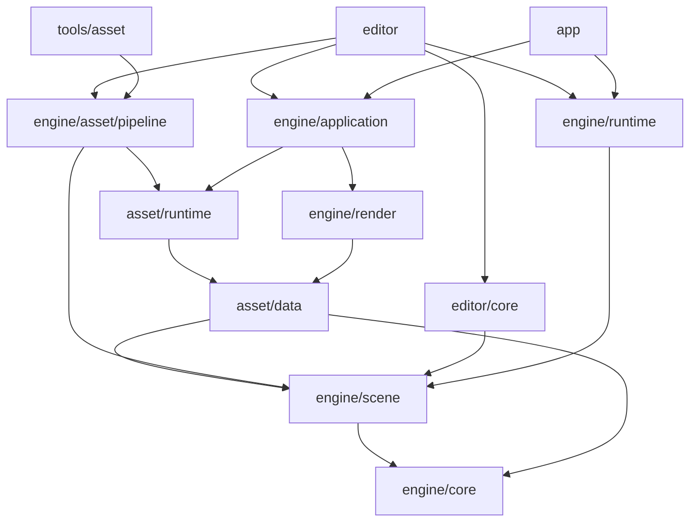

# 架构与目录约定

项目按引擎、编辑器、游戏与工具组织。Cargo 包是依赖和编译边界，目录使用业务含义，不按开发阶段建立产品结构。
桌面共同支持目标为 macOS、Windows、Linux；macOS 使用原生 Metal，Windows/Linux 共用原生 Vulkan 后端，暂不接入 DX12。新增通用功能按三个平台同步设计、实现和验收，平台差异收敛在 Application、Render 后端和打包适配中。共享数据协议与行为，硬件能力差异由显式能力检测和错误体现；后端保留显式多队列、原生显存别名和硬件光追的控制空间。

## 目录与依赖

```text
engine/
  core/                  identity.rs / storage.rs / input.rs / paths.rs / publication.rs / math.rs
  scene/                 components.rs / physics.rs / schema.rs / scene.rs / prefab.rs
  asset/data/            product.rs：CPU 产品协议
  asset/runtime/         store.rs：只读产品消费
  asset/pipeline/        导入、构建、打包、模板与项目配置库
  runtime/               session.rs / clock.rs / input.rs / physics.rs / character.rs：运行世界与模拟
  application/           application.rs / extract.rs / input.rs / timing.rs / icon.rs / macos.rs：宿主、采样、图标与提取
    resources/fonts/     内置中文字体与许可
  render/                frame.rs / worker.rs / shader.rs
    shaders/             正式 WGSL
    src/backend/metal/   renderer.rs / resources.rs / ui.rs
    src/backend/vulkan/  renderer.rs / device.rs / resources.rs / pipeline.rs / commands.rs / ui.rs
editor/
  core/                  document.rs：编辑文档与历史
  src/                   session.rs / export.rs / project.rs / close.rs / ui/
  resources/icons/       编辑器原版 PNG / ICNS / ICO 图标
app/
  src/                   游戏入口
  resources/icons/       独立游戏原版 PNG / ICNS / ICO 图标
tools/
  asset/                 资产 CLI：Cargo.toml / src/main.rs
  gpu/                   原生 GPU 能力诊断：Cargo.toml / src/ / shaders/
  launch/                launch.py / windows_icon.py / tests/：编辑器启动准备
  verify/                verify.py / check_boundaries.py / audit_dependencies.py：工程验收与审计
demo/assets/             默认作者项目
tests/fixtures/          按功能组织的独立测试项目
```



图中表示主要编译依赖，实际直接依赖由 `tools/verify/check_boundaries.py` 校验。`asset/data` 不导入源文件、不持有 Store 或 GPU；Render 可以依赖这些数据协议，但不依赖资产运行时加载器。`asset/runtime` 表示资产消费，`engine/runtime` 表示游戏运行，二者职责不同。
资产 Pipeline 是引擎的生产库，独立 Cargo 包 `comet-asset-pipeline` 供编辑器与资产 CLI 调用；tools/asset 只保留命令行入口。tools/launch 和 tools/verify 分别编排启动准备与工程验收，继续使用 Python 标准库。
App 不链接编辑器、资产生产库、glTF 或通用源图像导入器；Application 使用 png 解码内置或包内窗口图标，Render 使用它编码截图。数据层、资产生产和编辑文档不依赖窗口、GPU、模拟世界或脚本 VM。GPU 工具独立运行，不是游戏依赖。
`lib.rs` 组织模块和公共出口；不使用包揽项目状态的 Engine/Context 单例。

## 第三方依赖

第三方 Rust 库由 Cargo 下载到本机缓存（通常为 `$CARGO_HOME/registry`，默认 `$HOME/.cargo/registry`），不在仓库中复制一份 `3rdparty` 源码。
根 `Cargo.toml` 的 `[workspace.dependencies]` 管理共享约定，各包的 `Cargo.toml` 声明实际使用；`Cargo.lock` 锁定全部解析版本，更新依赖时一并审查。

### 已接入的主要依赖

| 用途 | 依赖 | 主要声明位置 |
| --- | --- | --- |
| 刚体与角色碰撞 | `rapier3d = 0.36.1` | 根 workspace、`engine/runtime/Cargo.toml` |
| 场景 ECS | `bevy_ecs` | `engine/scene/Cargo.toml` |
| 数学 | `glam` | 根 workspace、Core；消费者使用 `comet_core::math` |
| 序列化 | `serde`、`serde_json` | 根 workspace，各数据和工具模块 |
| 身份与摘要 | `uuid`、`sha2` | 根 workspace、`engine/core` |
| 错误上下文 | `anyhow` | 根 workspace、各消费者 |
| Vulkan 绑定与 Surface | `ash`、`ash-window` | `engine/render`，非 macOS 目标 |
| Metal 与系统对象绑定 | `objc2`、`objc2-metal`、Foundation、QuartzCore | `engine/render`、`tools/gpu`，macOS 目标 |
| 原生窗口句柄 | `raw-window-handle`、`raw-window-metal` | `engine/render` |
| Shader 翻译 | `naga` | `engine/render`：WGSL 输入、MSL/SPIR-V 输出 |
| 窗口与 UI | `winit`、`egui`、`egui-winit` | 根 workspace、Application、Editor、Render |
| 静态模型导入 | `gltf`、`base64`、`percent-encoding` | `engine/asset/pipeline` |
| PNG/JPEG 解码 | `image`、`png` | `engine/asset/pipeline` |
| 窗口图标解码、验收截图编码 | `png` | `engine/application` / `engine/render`，不用于导入作者源 |
| 临时测试项目 | `tempfile` | 各包的开发依赖 |

数学类型通过 Core 的小型门面集中导出，坐标/投影约定在同一处；门禁拒绝其他正式包直接依赖 glam。类型导出保留 glam 的实际类型身份，尚不是独立数值实现或稳定二进制 ABI。Rapier 内部数值类型留在 Runtime 适配层，持久协议继续使用既有数组。
项目只使用 bevy_ecs，不接入完整 Bevy 引擎；稳定字段 Schema 由本项目实现。Metal/Vulkan 的系统 SDK、loader 与驱动由系统提供，Cargo 包负责 Rust 绑定与调用。
原生 API 的 Rust 绑定可能携带构建脚本，但不等于编译 C/C++ 算法库；实际 normal/build 依赖图由审计工具检查。

### 已确定、尚未接入

| 功能 | 技术路线 | 状态 |
| --- | --- | --- |
| 导航构建与寻路 | rerecast / landmass | 尚未接入正式 Runtime 和资产产品 |
| 游戏脚本 | Rhai | 尚未接入正式 Runtime |

按实际消费者接入这些路线，不提前加入无消费者的依赖或原型构建路径。导航动态几何修改采用受影响区域重新烘焙并替换产品，局部避障不能替代几何切割；Rhai 与按阶段回调的脚本生命周期匹配。这些约束尚未进入正式 Runtime。
Rune 与 wgpu 不属于当前正式路线；引擎不依赖旧 C++ 引擎或 Jolt、Recast、glslang 等 C/C++ 实现。

## 身份、场景与字段

`EntityId`、`AssetId`、`InstanceId`、`WorldId` 为不同的非空 UUID 类型。ECS 槽位、内存地址和递增整数不作为持久身份。
Scene 私有持有 bevy_ecs World，存储 Identity、Transform、Model、Links、PhysicsBody、Character 具体组件；SceneSnapshot 是可独立验证和序列化的 CPU 值。
实体句柄携带世界与代次，跨世界或替换场景后失效。parent 唯一确定层级，Transform 使用父级局部变换；拒绝重复身份、缺失父级、层级环及无效本地引用。
实体引用区分 Local 与 External；External 保存场景资产和实体身份，当前校验所指资产为场景，不自动实例化跨场景内容。

| 组件 ID | 字段 ID | 协议字段 | 规则 |
| --- | --- | --- | --- |
| 1 Transform | 1/2/3 | translation / rotation / scale | 有限向量、归一化 xyzw 四元数 |
| 2 Model | 1/2/3 | mesh / surface.material / surface.roughness | 资产身份、资产身份、[0,1] 标量 |
| 3 Links | 1/2 | target / connections | 可空实体引用、实体引用数组 |
| 4 PhysicsBody | 1/2 | mass / friction | 正质量、非负摩擦系数 |
| 5 Character | 1/2 | move_speed / jump_speed | 正速度 |

场景快照当前版本为 2，新增可选的 `physics`、`character` 配置；仍读取版本 1，旧场景打开、快照和保存保留原版本与 UUID；首次添加物理组件时显式升级 base 至版本 2，撤销可恢复原版本，版本 1 不能携带物理组件。ContentSource 外层版本仍为 1，Prefab 展开采用内容中最高的场景版本；产品需随协议实现重新构建，metadata 身份不变。
字段 ID 和 JSON 键属于版本化协议，不随 Rust 字段重命名而改变。编辑与 Prefab 覆盖使用稳定的组件/字段 ID。
Schema 的读写、校验、引用分类和重映射供各消费者复用。复制子树分配新身份，重映射复制集合内的父级与本地引用，保留集合外引用及资产身份；候选校验成功后整体生效。

## 文档与运行世界

ContentSource 保存 base SceneSnapshot 与 PrefabInstance 声明，场景和 Prefab 共用作者格式。实例保存 InstanceId、Prefab AssetId、挂接父实体与字段覆盖。
实例实体身份由实例和源实体 UUID 确定性派生，嵌套实例同理；源更新后身份稳定，覆盖重新应用。展开检查循环、缺失依赖、目标及类型，最多 64 层，不创建临时 ECS 世界收集依赖。
当前覆盖目标是被引用 Prefab 的 base 实体，尚不支持跨层结构覆盖、移除源实体或完整结构编辑 UI。

Document 拥有 Edit 场景、Prefab 声明、历史与保存点。连续预览 commit 后成为一条历史；cancel 恢复。保存先原子发布作者文件，成功后移动保存点；失败保留 dirty 状态。作者文件保留声明和覆盖，不保存为失去关系的平铺实体。

Application 将窗口关闭请求交给应用决定，应用可以延后关闭并在确认后通知宿主退出。Editor 的 close.rs 管理未保存确认：确认期间冻结 Play、禁用编辑和快捷键，取消保留预览；保存先停止 Play 并沿用原有事务与路径校验，失败保留窗口供重试。后台导出完成前不退出进程。App 默认允许直接关闭。

macOS 宿主在 winit 初始化前创建 Comet 的 NSApplication 子类，把菜单、Cmd-Q 和 Dock 的 terminate: 转成窗口 performClose:，继续经过 winit 原有 CloseRequested 与退出确认；保留 winit 的委托和事件分发，不直接终止 AppKit。原生接入归 Application 的 macos.rs。
历史使用不可变 CPU 内容快照，undo/redo 共计最多 256 条，保存点与活动预览分别持有其状态。状态 ID 在成功变更时更新，is_dirty 为常数时间查询；返回原值的预览、取消和撤销回保存点不会误标脏。单条历史仍与场景体积相关，当前没有字节预算。
Scene 按内容 revision 缓存 Arc 快照；姿态未变化时不失效，成功写回或替换时才重建。Editor 按文档世界/revision 和已接纳产品索引摘要缓存 Prefab 展开结果，UI 和帧请求共享同一不可变快照。预览、undo/redo、资产刷新和运行世界切换分别使对应缓存失效；渲染提取中的变换与绘制遍历尚未实现完整增量更新。
Play 从已校验快照创建新的运行世界，Stop 销毁运行世界；编辑文档的所有权和历史不参与交换。
Runtime 使用 60 Hz 固定步，游戏时间由已完成步数计算，独立于渲染帧编号。每次最多补 8 步，超出 0.25 秒的帧时间及超额整步记入掉时，保留不足一步的余量和插值系数；当前尚未对呈现姿态做插值。暂停与单步不积累欠账，UI 单步请求在本轮输入授权之后、提取之前执行。动画、脚本、导航和音频尚未接入。

动作契约位于 Core，不依赖 egui/winit。Application 统一采样默认键鼠映射；Runtime 保存连续状态、累加鼠标位移，并按顺序缓存按下/释放事件。没有固定步的帧不丢失快速点按；补步时边沿和鼠标位移只交付给第一步，后续步仍可读取持续状态。输入队列有上限，溢出或非有限值报错，不覆盖已接纳的输入与时钟。
新世界、暂停、宿主恢复及输入授权恢复会建立新基线，保留当前持续状态，不重放旧边沿或鼠标位移。UI 文本输入拥有键盘时关闭游戏输入授权，游戏时钟仍继续。宿主失焦、遮挡、零尺寸或平台挂起时冻结模拟并清空欠账；恢复首帧时间为零，交换链或烟测注入的呈现尺寸不决定游戏时间。

## 物理与角色

Scene 只保存纯数据配置，Rapier 对象和 EntityId → 句柄映射由 Runtime 私有持有；Application、Render 和资产模块不引入 Rapier。使用 `std/dim3/f32/enhanced-determinism`，不启用线程并行或原生算法绑定。实体按稳定 UUID 顺序插入，固定步结果在同一平台不受渲染帧率及源数组顺序影响；不承诺跨平台逐位一致。

支持 Fixed、Dynamic、Kinematic 刚体和 Box、Sphere、Y 轴 Capsule；碰撞层与 mask 使用完整 32 位双向匹配。动态物体开启 CCD，非角色 Kinematic 接受速度；触发器记录每个固定步的进入/离开，`trigger_events()` 包含最近一次 advance 的全部事件，下次 advance 清空。当前没有回调重入或永久事件积压。
PhysicsBody 必须位于场景根，允许带可视子树；缩放必须为正，Sphere/Capsule 还要求等比缩放。每体一个碰撞体，尚不支持三角网格碰撞、复合体、关节或父级驱动物理。非法配置在资产构建、加载和 Play 启动时拒绝。

每个场景最多一个接收玩家输入的 Character，要求直立的非传感器 Kinematic Capsule。`character.rs` 负责移动、跑步、重力、按下边沿跳跃、坡度限制、台阶和贴地；Rapier 提供形状查询和移动平台摩擦。Application 将相机平面方向换成世界 X / 负 Z 输入，并在模拟后跟随角色，Editor Play 与 App 使用同一实现。当前不处理蹲伏、动态物体推动、动画或根运动。

每步先计算角色目标，再推进 Rapier，最后批量校验并写回 ECS 的位置/旋转，保留实体句柄、世界和作者缩放。Play 的暂停、单步和宿主冻结走同一模拟路径；Stop 丢弃全部物理状态。运行中物理配置只读，普通字段编辑不能覆盖物理体变换；显式 `teleport` 重置速度和着地状态，`set_linear_velocity`、`apply_impulse` 分别验证目标运动类型。Inspector 的物理面板位于 ui/inspector/physics.rs，为作者根对象提供刚体/胶囊角色的添加和移除、运动类型、形状尺寸、触发器、质量、摩擦、弹性、完整 32 位过滤及角色参数。刚体和角色作为同一候选交给 Document，先校验包含 Prefab 的完整展开结果，再发布到编辑世界；拖动结束提交为一条历史，失败保留上个有效预览。运行时禁用配置修改。Prefab 实例继续使用原有稳定字段覆盖；新增、移除组件与形状等结构修改仅作用于当前源的 base 实体，不新增结构覆盖协议。属性面板支持滚动。

默认 demo 沿用原场景和 metadata，增加地面/静态物体碰撞、落体与角色，复用已有多材质网格和材质；角色用方块显示胶囊外包围尺寸，不新增模型二进制。

## 资产生产与消费

1. Pipeline 扫描项目 `assets/`，导入 `.scene`、`.prefab`、`.mesh`、`.material`、PNG、静态 glTF/GLB；前四种自有作者格式仍使用 JSON 内容。
2. 源旁的 `<文件名>.meta` 保存版本与 AssetId。重命名时随源移动；复制为新资产时分配新身份。目录重构保留现有 metadata 与协议版本。
3. 构建持有项目与输出锁，读取输入快照，校验内容、引用类型、依赖及展开；发布前复核源集合、字节、metadata 和外部文件。
4. 产品写入 `products/<AssetId>/<SHA256>.json`，保存版本、身份、输入摘要及 CPU payload。相同内容复用文件，不就地覆盖旧版本。
5. 最后通过同目录临时文件、sync 与 rename 原子发布 `index.json`；失败时旧索引仍可使用。当前不自动清理旧产品版本。
6. AssetStore 只读产品目录。打开与刷新时全量校验候选索引、摘要、协议、依赖及展开，成功后切换；缓存使用 Arc，消费者已持有的旧版本继续有效。

当前构建仍解析全部源，复用的是未变化的产品文件，尚无导入计算缓存。资产打开/刷新仍全量验证，尚未实现大场景按需流送。
自有源、metadata、产品和索引有显式版本，未知版本/字段报错。旧 C++ 自有格式需显式单向迁移；源路径不参与资产身份。
源文件与 metadata 使用简短后缀，例如 `main.scene` / `main.scene.meta`、`showcase.gltf` / `showcase.gltf.meta`，metadata 追加到完整源文件名，避免同名不同类型的资产共享身份文件。遇到旧复合后缀时构建会报错；需一起重命名源与 metadata，保留文件内容和 UUID，避免遗漏资源或重新分配身份。

glTF/GLB 按 primitive 生成稳定网格、材质、纹理子产品，保留节点层级与 TRS，支持外部/内嵌 buffer、PNG/JPEG、无索引三角形与缺失法线生成。外部 URI 限本地同目录或子目录，读取的外部文件参与输入复核。
子身份按源 AssetId、语义和唯一名称派生；无名/重名项及 primitive 使用索引，重命名或索引变化可能使旧覆盖失效并报错。
当前材质为不透明 metallic/roughness、base-color factor/texture、UV0；尚无蒙皮、动画、morph、稀疏 accessor、必需扩展、透明、法线/遮蔽/自发光或 packed metallic-roughness 贴图支持。

## 宿主、渲染与反馈

Application 为 Editor/App 统一配置内置 Noto Sans SC 中文回退字体；字体数据复用旧仓库，通过 LFS 管理并嵌入程序，不依赖开发机字体目录。编辑器与 App 的 PNG 图标嵌入各自程序，Application 统一解码，Windows 同时设置窗口和任务栏图标；macOS 系统图标来自 App 内 ICNS。界面固定使用简体中文，用户对象名称、路径、协议标识和原始诊断保留其内容；中文字体支持不等于系统 IME 已验收。
Application 在主线程处理 winit/egui 事件和本轮应用更新，再只读场景与资产，提取不可变帧数据。egui 固定单 pass，避免布局重排重放命令。窗口保留到 Surface 和 Worker 退出后。
RenderWorker 在专用线程创建后端，使用 1 个待处理帧槽、2 个反馈槽提供背压；关闭时断开发送与反馈再 join，避免反馈满导致死锁。诊断只保留最近 120 条。
帧与拾取反馈携带帧号、WorldId、View 和目标代次；resize/零尺寸更新代次，拒绝旧世界或旧目标反馈。当前拾取为帧快照上的 CPU 三角形射线检测。

渲染显式执行 Shadow → PBR/Depth → UI。共享 WGSL、顶点与 uniform 布局，由 Naga 生成 MSL/SPIR-V；后端负责原生资源、上传、缓存、命令和呈现。
Metal 使用 CAMetalLayer；主线程创建的 Surface 按 `raw-window-metal` 契约交给 Worker，不自定义未证明安全的 Send/Sync。Vulkan 使用 ash、原生分配/绑定、RenderPass、Fence/Semaphore 和 Swapchain。
投影为 Z∈[0,1]、Y-up，Vulkan 采用负 viewport height 保持一致。

正式渲染目前为单队列并等待本帧 GPU 完成，CPU 可以准备下一帧；尚无 GPU 多帧并行、RenderGraph 或独立异步上传。多队列/显存别名/光追的 Metal 直接能力检查保留在 `tools/gpu`，不代表正式帧调度已经接入，也不代表整帧性能提升。

## 打包与目录稳定性

Core 的 ProjectPaths 统一解析作者路径，使用真实路径和路径组件检查 assets 归属；新目标解析现有父目录。Editor 在打开和保存时校验，导出复用同一规则并拒绝目的地与作者资产/产品输入相互包含。Document 只负责内容事务与保存，不持有项目路径策略。

`start.sh` 顺序构建 Debug Editor 和 Release App；Core build script 嵌入共享构建身份与目标三元组。启动器对生产源码、Cargo.lock、清单、Shader、图标和构建配置取指纹，构建前后不一致则拒绝配对。macOS 同时把 Debug Editor 复制到 `target/editor-apps/` 的不可变 App 快照，写入原版编辑器 ICNS 和 Info.plist，签名并验证；以签名后的实际程序摘要与 App 配对，日常仍由 start.sh 传入项目与模板参数。Windows 原生终端通过 `python tools/launch/launch.py` 调用同一流程，等待编辑器退出并保留返回码；启动器将 Cargo 产物复制到 `target/windows-programs/` 候选快照，通过 `tools/launch/windows_icon.py` 写入并读回原版 ICO 的各尺寸及现有语言资源，以写入后的程序摘要完成配对。模板清单版本为 4（App 命名；旧模板需重新运行启动器准备），另存不可变快照，校验 App/Editor、游戏 ICNS 与附带许可文件的摘要，现有快照不被后续 Cargo 构建覆盖。模板失配提示重新运行启动器。
Editor 的 export.rs 持有导出配置、后台任务和子进程管理；UI 提供启动场景、额外场景、目的地和导出后运行。先停止 Play、提交并保存作者内容，再由后台线程调用 Pipeline 构建，检查保存版本未改变，收集所选场景的依赖并集。任务使用已保存输入并显示阶段与有界日志，期间禁用修改操作；没有导出时编译 Rust 的路径。
Pipeline 的 package.rs 在正式目的地同级创建私有候选，复制后校验产品索引、所选场景、程序摘要及许可文件摘要；签名/封装完成后使用不覆盖目标的目录重命名发布。普通错误仅清理本次候选，进程中断可能留下临时候选，正式名称不提前出现。

包清单版本为 3，记录启动场景、包含场景、运行程序及可选项目 PNG 摘要；旧版包需重新导出。编辑器导出另记录匹配模板的 RuntimeIdentity。项目根 project.json（版本 1）由 Pipeline 的 ProjectSettings 管理，使用 AssetId 引用游戏图标；无配置时沿用默认图标。Editor 的 project.rs 提供项目设置，选择后原子保存并验证图标资产，拒绝外部覆盖和配置符号链接。导出前后比较已捕获的项目设置，Pipeline 从本次产品索引加载纹理，验证正方形及 16～1024 像素尺寸，复用现有 Rust image/png 生成窗口 PNG、各尺寸 ICNS 与 Windows 资源；不引入 Python 图像依赖。仅在候选包中写入图标，Windows 更新后读回校验，原始模板不变。图标产品无需进入场景依赖闭包，发布的是已生成的包内图标。

macOS `.app` 使用 Contents/MacOS 与 Contents/Resources，在 Info.plist 声明 CFBundleIconFile，完成图标写入后执行 ad-hoc codesign 并校验；普通目录保留 exe 旁的资源布局。App 根据自身路径定位清单、图标和产品，校验图标摘要、协议/构建身份，拒绝选用清单外场景，不依赖 cwd 或作者源。Linux 使用包内 PNG 设置窗口图标，桌面菜单注册仍属后续分发接入。资产 CLI 的低层 pack 仍接受调用方提供的既有二进制，程序配对由调用方承担；日常导出统一走编辑器的模板校验。

当前支持可搬移目录和 macOS 本机签名 App；证书签名、公证、安装器及运行时场景切换仍未实现。额外场景表示已打包的资源，不代表关卡切换玩法已经接入。
目录和包命名按业务职责维护。阶段编号仅用于迁移计划，不进入正式源码、示例路径、包名和当前验收命令。
